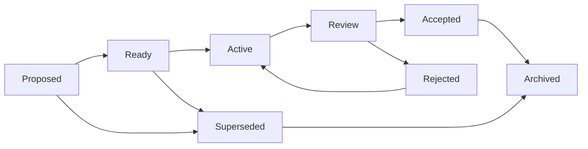

# AURA - Plan integral de desarrollo

**Estado:** propuesta inicial para validación  
**Versión:** 0.1  
**Fecha:** 2026-08-10  
**Documento rector:** `Proyecto AURA.docx`

## 1. Interpretación del producto

AURA (Adaptive Unified Reasoning Architecture) será una plataforma SaaS multi-tenant que crea el ambiente necesario para definir y gestionar proyectos basados en SCHEMA. AURA no aplicará SCHEMA literalmente para desarrollar su propio código ni convertirá toda intervención interna en una EXEC. SCHEMA será un modelo de proyecto soportado por el producto, con sus conceptos configurables, trazables y versionados.

La unidad central del producto es la **EXEC**. Cada EXEC debe conservar su definición, estimación, actores, cambios de custodia, ejecuciones, prompts relevantes, herramientas, modelos, evidencia, pruebas, revisión y aceptación humana. El valor diferencial de AURA no es sólo administrar proyectos: es poder reconstruir quién hizo qué, con qué recurso, cuándo, sobre qué entrada, con qué resultado y quién lo certificó.

AURA no debe copiar el dominio funcional del sistema técnico usado como referencia. Sí debe aprovechar su aprendizaje de arquitectura por capas, SQL Server, multi-tenancy, autenticación, frontend, auditoría y despliegue, corrigiendo las debilidades identificadas en la fundación técnica.

### 1.1 Resultado esperado

El producto completo debe permitir:

1. Administrar la plataforma SaaS, tenants, planes y suscripciones.
2. Administrar usuarios, membresías y permisos por tenant y por proyecto.
3. Crear proyectos AURA basados en Schema.
4. Registrar personas, modelos de IA, automatizaciones, herramientas e IDE como recursos asignables.
5. Definir, estimar y ejecutar EXEC con criterios de aceptación y evidencia esperada.
6. Mostrar en todo momento quién tiene la custodia operativa de cada EXEC.
7. Registrar sesiones, invocaciones, modelos, versiones, herramientas, prompts, resultados, pruebas y evidencias.
8. Cerrar la producción de una EXEC y someterla a revisión y aceptación humana.
9. Calibrar OP e IPC con datos reales, sin confundir tamaño, esfuerzo y duración de calendario.
10. Presentar tableros, grillas y KPI de proyecto, tenant y plataforma.
11. Conservar artefactos en nube y sincronizarlos de forma controlada con carpetas locales.
12. Abrir un proyecto en un IDE autorizado mediante un agente local seguro.

### 1.2 Límites iniciales

El primer producto no debe intentar resolver simultáneamente marketplace, facturación automática, todos los proveedores de nube, todos los IDE, planificación financiera avanzada ni agentes autónomos sin supervisión. El MVP debe probar primero el circuito completo **Tenant -> Proyecto basado en SCHEMA -> EXEC -> prompt -> resultado de codificación -> evidencia -> revisión -> aceptación**.

Para llegar antes a producción, el traspaso entre ChatGPT y VS Code será inicialmente manual y documentado: ChatGPT actuará como analista funcional, generará un paquete de prompt listo para codificación y el resultado del IDE volverá para revisión. La integración automática con IDE, el agente local y la sincronización avanzada quedan para una evolución posterior a la primera salida productiva.

El manual web actual de Schema es documentación útil y debe preservarse como producto documental independiente o integrarse más adelante como centro de ayuda. No es la base de la aplicación transaccional AURA y su esquema Drizzle actual está vacío.

## 2. Decisiones de modelado

### 2.1 Separar cuenta, autorización y ejecución

El esquema jerárquico inicial mejora si se separan tres conceptos:

| Capa | Qué representa | Ejemplos |
|---|---|---|
| Cuenta y alcance | Dónde puede ingresar y administrar una persona | Platform Owner, Tenant Owner, Tenant Admin |
| Rol de proyecto | Qué puede hacer dentro de un proyecto | Project Leader, Senior Analyst, Developer, Tester, Client Owner, Auditor |
| Rol cognitivo | Qué responsabilidad ocupa en una EXEC | Explorador, Arquitecto, Constructor, Revisor adversarial, Verificador, Sintetizador |

Una persona puede tener varios roles de proyecto y varios roles cognitivos según la EXEC. Un modelo de IA o un IDE no debe fingirse como usuario humano: debe registrarse como **ejecutor digital** o **herramienta**, con credenciales técnicas limitadas sólo cuando necesite operar mediante API.

### 2.2 Jerarquía de autorización recomendada

- **Platform Owner:** administra tenants, catálogo de planes, suscripciones, soporte y observabilidad global. No accede por defecto al contenido de proyectos de un tenant.
- **Tenant Owner:** responsable principal de la organización y su suscripción.
- **Tenant Admin:** administra miembros, recursos y proyectos delegados.
- **Billing Admin:** opcional; administra plan y facturación sin acceso a contenido técnico.
- **Project Leader:** configura el proyecto, prioridad, IPC, recursos, permisos y aceptación final.
- **Senior Analyst:** define y revisa EXEC, criterios, evidencia y certificación delegada.
- **Developer:** ejecuta trabajo, registra resultados y solicita revisión.
- **Tester/QA:** verifica criterios y adjunta evidencia de prueba.
- **Client Owner:** representa al cliente y puede validar valor o decisiones de alcance.
- **Auditor/Viewer:** acceso de lectura a trazabilidad y evidencia autorizada.

Los nombres serán configurables en la interfaz, pero los permisos atómicos serán la fuente real de autorización.

### 2.3 AURA y SCHEMA

- **AURA** es el producto SaaS, su arquitectura, seguridad, persistencia e integraciones.
- **SCHEMA** es una metodología que los usuarios podrán seleccionar para estructurar y gestionar sus proyectos dentro de AURA.
- El desarrollo interno de AURA usará un criterio mínimo de gestión por etapas, intervenciones y prompts de codificación; no necesita reproducir toda la metodología SCHEMA.
- Los conceptos SCHEMA soportados por el producto deben versionarse. Una modificación metodológica requiere una decisión de producto registrada, no sólo un cambio de pantalla.

## 3. Flujo funcional de una EXEC

Los estados canónicos se conservan:



La acción del productor de “cerrar” no debe convertir directamente la EXEC en `Accepted`. Debe:

1. finalizar la sesión o ejecución activa;
2. adjuntar entregable y evidencia mínima;
3. mover la EXEC a `Review`;
4. crear una solicitud de revisión;
5. asignar la custodia al revisor humano correspondiente;
6. registrar certificación, observaciones y resultado;
7. producir un `AcceptanceRecord` al aceptar o rechazar.

Los estados temporales como `AwaitingHuman`, `AwaitingTool`, `Blocked` o `Paused` deben ser motivos operativos dentro de `Active`/`Review`, no nuevos estados canónicos que rompan Schema.

### 3.1 “Quién tiene la pelota”

La custodia actual se deriva del último evento válido de transferencia. Nunca se sobreescribe el historial. Cada `CustodyEvent` contiene:

- EXEC y revisión;
- actor de origen y destino;
- tipo de actor: humano, IA, automatización o herramienta;
- rol cognitivo ocupado;
- fecha y hora UTC;
- motivo, estado previo y estado posterior;
- usuario humano que autorizó la transferencia;
- vencimiento esperado y señal de bloqueo opcional.

### 3.2 Trazabilidad mínima por ejecución

Cada interacción relevante debe poder registrar:

- actor humano responsable;
- IA que preparó o refinó el prompt;
- proveedor, modelo y versión declarada;
- IDE, agente o automatización que ejecutó;
- inicio, fin, duración y estado;
- prompt y respuesta como artefactos versionados o sus referencias y hashes;
- archivos de entrada y salida;
- commit, rama o revisión cuando exista Git;
- pruebas ejecutadas y resultado;
- evidencia aportada;
- decisiones y excepciones;
- datos sensibles omitidos o redactados.

La captura de prompts completos será configurable. Secretos, datos personales y credenciales deben redactarse antes de persistirlos.

## 4. Arquitectura objetivo

### 4.1 Componentes

```text
AURA.sln
├── AURA.Domain              # entidades, reglas e invariantes
├── AURA.Application         # casos de uso, contratos, autorización
├── AURA.Infrastructure      # EF Core, SQL Server, email, storage, integraciones
├── AURA.Api                 # HTTP API, auth, middleware, health
├── AURA.Web                 # React + TypeScript
├── AURA.Agent               # agente local para IDE y sincronización
├── AURA.Contracts           # contratos públicos/versionados, si se justifica
└── tests/
    ├── Unit
    ├── Integration
    ├── Architecture
    ├── Security
    └── EndToEnd
```

### 4.2 Línea técnica recomendada

- Backend ASP.NET Core sobre una versión LTS soportada, fijada en `global.json` y decidida mediante ADR al iniciar.
- API REST con contratos explícitos, `ProblemDetails`, validación central, versionado y OpenAPI.
- SQL Server y Entity Framework Core compatible con el runtime elegido.
- Configuraciones EF por entidad y migraciones controladas; sin SQL correctivo oculto durante el arranque productivo.
- React, TypeScript estricto, Vite, React Router, TanStack Query y un cliente HTTP tipado.
- Tailwind y kit UI neutral, accesible y responsive.
- Procesamiento asíncrono para sincronización, email, cálculo agregado y webhooks.
- Outbox para eventos que deban llegar de forma fiable a integraciones.
- Logs estructurados, correlation ID, métricas, trazas, health checks y auditoría separada del log técnico.

### 4.3 Autenticación y sesión

- Identidad de plataforma explícita; nunca representar al Owner con un tenant vacío.
- Membresía usuario-organización muchos-a-muchos.
- Roles como agrupadores de permisos y políticas de autorización en backend.
- Email verificado, invitaciones, recuperación de contraseña, sesiones revocables y MFA preparado.
- Para la web, preferir sesión segura mediante cookie `HttpOnly`, `Secure` y `SameSite` o patrón BFF.
- Para el agente local, usar emparejamiento de dispositivo y credencial revocable de alcance mínimo.
- Rate limiting, bloqueo progresivo, auditoría de acceso y respuestas anti-enumeración.

### 4.4 Multi-tenancy

Todas las entidades tenant-scoped contienen `TenantId`. El aislamiento se implementa en capas:

1. tenant resuelto desde la identidad autenticada, no desde un header confiado del cliente;
2. políticas de autorización;
3. filtros globales y claves compuestas en EF/SQL;
4. pruebas automáticas de aislamiento;
5. operaciones globales encapsuladas y auditadas;
6. soporte de plataforma sin acceso silencioso al contenido.

### 4.5 Base de datos de desarrollo

Se usará la instancia SQL Server indicada en el documento rector y una base propia `AURA`. La credencial proporcionada es sólo de desarrollo: debe cargarse mediante User Secrets o variable de entorno local, no incorporarse a archivos versionados ni repetirse en documentación nueva. Producción usará una identidad de mínimo privilegio, cifrado en tránsito y un secret store.

### 4.6 Artefactos, nube y sincronización local

La base de datos guarda metadatos, relaciones, estados y hashes. Los archivos grandes se guardan mediante `IArtifactStore` en almacenamiento de objetos o un proveedor configurado.

El orden recomendado es:

1. storage cloud nativo de AURA;
2. abstracción y cola de sincronización;
3. un conector piloto de terceros;
4. OneDrive y Google Drive como conectores separados;
5. reglas de conflicto, retención, cuota y auditoría.

El navegador no puede sincronizar de forma continua una carpeta local ni abrir cualquier IDE de manera segura. `AURA.Agent` será una aplicación local emparejada que:

- registra dispositivos autorizados;
- permite sólo carpetas y comandos incluidos en una allowlist;
- recibe solicitudes firmadas y de corta duración;
- muestra confirmación humana según política;
- abre el IDE mediante perfiles configurados;
- sincroniza cambios con hashes y control de conflictos;
- reporta progreso, errores y versión del agente;
- puede revocarse remotamente.

## 5. Modelo de datos inicial

### 5.1 Plataforma e identidad

- `Users`, `UserProfiles`, `EmailVerificationTokens`, `PasswordResetTokens`, `Sessions`.
- `Tenants`, `TenantMemberships`, `Invitations`.
- `Roles`, `Permissions`, `RolePermissions`, `MembershipRoles`.
- `Plans`, `PlanFeatures`, `Subscriptions`, `UsageCounters`.

### 5.2 Proyectos y recursos

- `Projects`, `ProjectMemberships`, `ProjectRoles`, `ProjectSettings`.
- `HumanResources` para perfiles de participación, sin duplicar la identidad.
- `AiProviders`, `AiModels`, `AiModelVersions`.
- `Tools`, `IdeProfiles`, `Automations`.
- `AgentDevices`, `AgentPairings`.
- `StorageConnections`, `SyncProfiles`, `SyncRuns`, `SyncConflicts`.

### 5.3 Schema y EXEC

- `Execs`, `ExecRevisions`, `ExecDependencies`.
- `AcceptanceCriteria`, `ExpectedEvidence`.
- `CognitiveRoles`, `ExecRoleRequirements`, `ExecAssignments`.
- `CustodyEvents`, `ExecStatusEvents`, `Blockers`.
- `ExecEstimates` con CC, FC, OP, IPC aplicado y capacidad efectiva.
- `CalibrationRecords` con estimación, esfuerzo real, duración y desvío.

### 5.4 Producción, evidencia y gobierno

- `WorkSessions`, `InvocationRuns`, `PromptArtifacts`.
- `Deliverables`, `Artifacts`, `EvidenceItems`, `TestRuns`.
- `ReviewRequests`, `ReviewFindings`, `AcceptanceRecords`.
- `DecisionRecords`, `RiskItems`, `Comments`, `Notifications`.
- `AuditEvents`, `OutboxMessages`, `IntegrationEvents`.

Los eventos de auditoría, custodia, estado y aceptación son append-only. Las correcciones se agregan como nuevos eventos vinculados; no se reescribe la historia.

## 6. Módulos de producto

### Portal Platform Owner

- tenants, estado y soporte;
- planes, features, cuotas y suscripciones;
- métricas operativas sin exposición indebida de contenido;
- administración de plantillas globales y conectores;
- auditoría de acciones de plataforma.

### Portal Tenant

- perfil, miembros, invitaciones y permisos;
- catálogo de recursos humanos y digitales;
- proyectos y plantillas Schema;
- storage, agentes, IDE e integraciones;
- uso del plan y auditoría.

### Espacio de proyecto

- resumen, memoria, decisiones y riesgos;
- backlog de EXEC y dependencias;
- tablero de flujo y custodia;
- ficha completa de EXEC;
- sesiones, prompts, ejecuciones, entregables y evidencia;
- revisión, certificación y aceptación;
- calibración, métricas y reportes.

### Vistas prioritarias

- grilla multi-proyecto por tenant;
- tablero de EXEC por estado;
- bandeja “Tengo la pelota”;
- bandeja de revisiones pendientes;
- timeline auditable de una EXEC;
- dashboard de Project Leader;
- conflictos de sincronización y dispositivos.

## 7. Roadmap mínimo hacia producción

El desarrollo interno de AURA se gestionará mediante **etapas, intervenciones y paquetes de prompt**, no mediante la aplicación literal de SCHEMA. Cada etapa tiene un peso fijo para informar evolución acumulada. El porcentaje sólo aumenta cuando el gate de la etapa está aceptado; no se informará avance ficticio por tareas parcialmente realizadas.

| Etapa | Peso | Evolución acumulada al cerrar | Resultado |
|---|---:|---:|---|
| 0. Definición mínima | 10% | 10% | alcance, arquitectura y flujo aprobados |
| 1. Base desplegable | 15% | 25% | aplicación vacía operativa en Staging |
| 2. Núcleo SaaS | 20% | 45% | identidad, tenants y permisos |
| 3. Proyectos SCHEMA | 20% | 65% | proyectos, participantes y EXEC básicas |
| 4. Prompts y trazabilidad | 15% | 80% | circuito ChatGPT -> VS Code -> revisión |
| 5. Tablero mínimo | 10% | 90% | seguimiento, porcentaje y métricas esenciales |
| 6. Producción | 10% | 100% | sistema endurecido, desplegado y operable |

### ETAPA 0 - Definición mínima (10%)

**Entregables:** alcance MVP, actores y permisos, modelo mínimo, arquitectura, mapa de pantallas, roadmap, plantilla de prompt y primer paquete para VS Code.

**Gate:** Product Owner acepta el recorrido Tenant -> Proyecto SCHEMA -> EXEC -> Prompt -> Resultado -> Revisión.

### ETAPA 1 - Base desplegable (15%)

**Entregables:** solución backend/frontend, SQL Server, migración inicial, configuración segura, health check, logging, tests mínimos y despliegue automatizable en Staging.

**Gate:** build reproducible, migración desde cero, smoke test y acceso a Staging.

### ETAPA 2 - Núcleo SaaS (20%)

**Entregables:** login, recuperación básica, Platform Owner, tenants, usuarios, membresías, roles y aislamiento multi-tenant.

**Gate:** creación de tenant y usuario operativo, con prueba automática que impida acceso cruzado.

### ETAPA 3 - Proyectos basados en SCHEMA (20%)

**Entregables:** proyectos, participantes, recursos, configuración SCHEMA y CRUD mínimo de EXEC con estado, responsable, criterios y evidencia.

**Gate:** un Tenant Admin crea un proyecto SCHEMA y un Project Leader deja una EXEC lista para codificación.

### ETAPA 4 - Prompts y trazabilidad de codificación (15%)

**Entregables:** ChatGPT registrado como analista funcional, paquetes de prompt versionados, VS Code como entorno ejecutor, carga manual del informe de codificación, evidencias, revisión y aceptación.

**Gate:** un cambio real completa el circuito ChatGPT -> prompt -> VS Code -> resultado -> revisión humana, con fecha/hora y trazabilidad.

La copia entre ChatGPT y VS Code será manual en esta versión. Automatizar la apertura del IDE no debe bloquear producción.

### ETAPA 5 - Tablero mínimo (10%)

**Entregables:** grilla de proyectos, etapa actual, siguiente etapa, responsable, porcentaje acumulado, últimas intervenciones, EXEC por estado y revisiones pendientes.

**Gate:** el porcentaje se deriva de etapas aceptadas y cada dato del tablero puede rastrearse a su fuente.

### ETAPA 6 - Producción (10%)

**Entregables:** pruebas E2E críticas, permisos, seguridad, backup/restore, observabilidad, publicación, rollback, manual operativo y piloto corto.

**Gate:** restore probado, riesgos críticos cerrados, recorrido E2E aprobado y autorización de go-live.

### Después de producción

- agente local para abrir VS Code y otros IDE;
- sincronización local/cloud y conectores OneDrive/Google Drive;
- facturación automática;
- MFA/SSO empresarial;
- API pública, webhooks y service accounts;
- automatizaciones y agentes IA gobernados;
- analítica avanzada y calibración completa de métricas SCHEMA.

## 8. Criterio de entrega rápida

La prioridad será documentar sólo lo necesario para construir, verificar, desplegar y operar la siguiente porción vertical. Cada intervención debe terminar, como mínimo, con:

1. decisión o requisito funcional actualizado;
2. prompt de codificación autocontenido cuando corresponda;
3. criterios de aceptación y pruebas esperadas;
4. resultado o evidencia recibida desde VS Code;
5. estado del proyecto actualizado;
6. etapa actual y siguiente etapa explícitas.

Las integraciones sofisticadas no entran antes de que exista una versión productiva usable. El primer corte productivo incluye gestión manual de prompts y resultados; la automatización se agrega después con evidencia de uso real.

## 9. Estrategia de pruebas y gates

| Área | Prueba mínima obligatoria |
|---|---|
| Dominio | invariantes de estado, cálculo OP, aceptación y custodia |
| Multi-tenancy | toda consulta y comando probados con tenant ajeno |
| Autenticación | verificación, reset, revocación, rate limit y permisos |
| API | integración con SQL Server real o efímero y contratos OpenAPI |
| Auditoría | eventos completos, ordenados, inmutables y correlacionados |
| Frontend | componentes críticos, permisos y flujos E2E |
| Storage | hash, malware, cuota, reintento, revocación y aislamiento |
| Agente | pairing, firma, allowlist, rutas, comandos y actualización |
| Operación | migración, rollback, backup, restore, health y alertas |
| Seguridad | SAST, dependencias, secretos, threat model y pruebas manuales |

Una feature no está terminada si sólo funciona en la interfaz. Debe incluir autorización backend, auditoría, pruebas, observabilidad, documentación operativa y evidencia de aceptación.

## 10. KPI iniciales

- porcentaje de EXEC con criterios definidos antes de iniciar;
- aceptación al primer ciclo;
- lead time total y tiempo por custodio;
- tiempo bloqueado y causa;
- throughput de EXEC aceptadas;
- trabajo en curso por persona/proyecto;
- cobertura de evidencia;
- tasa de retrabajo y reapertura;
- desvío OP/HH estimado contra real;
- IPC observado por tenant, tipo de EXEC y ventana;
- escalamiento humano;
- fallos de sincronización y tiempo de resolución;
- incidentes de autorización o aislamiento.

Cada KPI debe documentar fórmula, unidad, ventana, filtros, fuente, propietario y advertencias. No se usarán métricas de actividad —cantidad de prompts, horas conectadas o volumen de texto— como sustituto automático de valor o productividad.

## 11. Riesgos principales

| Riesgo | Mitigación planificada |
|---|---|
| Confundir roles de acceso con roles cognitivos | modelos separados y permisos atómicos |
| Acceso cruzado entre tenants | claves compuestas, filtros, policies y pruebas negativas |
| Auditoría incompleta o editable | eventos append-only, hashes, correlación y acceso restringido |
| Prompts con secretos o datos personales | redacción, clasificación, cifrado y política de retención |
| Abrir IDE/comandos desde web | agente emparejado, allowlist, firma, confirmación y revocación |
| Conflictos cloud/local | versionado, hashes, resolución explícita y nunca sobrescritura silenciosa |
| Exceso de alcance por integraciones | abstracción común y un proveedor piloto por vez |
| KPI usados como vigilancia individual | gobierno de métricas y foco en flujo/resultado |
| IPC prematuro | piloto de 8 a 15 EXEC y rangos con evidencia |
| Dependencia de una marca IA | catálogo neutral de proveedor/modelo/versión |
| Crecimiento de eventos y archivos | partición, archivado, cuotas y políticas de retención |
| Deuda heredada del proyecto de referencia | código AURA nuevo y checklist explícito de no reutilización funcional |

## 12. Criterio mínimo de gestión del desarrollo

El trabajo se organizará en **intervenciones numeradas**. Una intervención puede ser análisis, documentación, generación de prompt, codificación, revisión o despliegue. No es obligatorio modelarla como EXEC.

### Flujo ChatGPT -> VS Code

1. El usuario define el objetivo o comparte el resultado previo.
2. ChatGPT revisa el contexto vigente y actúa como analista funcional.
3. ChatGPT actualiza sólo la documentación afectada.
4. ChatGPT genera un prompt autocontenido para VS Code.
5. El usuario entrega el prompt al entorno de codificación.
6. VS Code devuelve resumen, archivos modificados, pruebas y problemas.
7. ChatGPT contrasta el resultado con los criterios de aceptación.
8. El usuario acepta o solicita corrección.
9. Se actualizan porcentaje, fecha/hora, etapa actual y siguiente etapa.

### Contenido obligatorio del prompt para VS Code

- identificador y etapa;
- objetivo funcional;
- contexto y archivos fuente;
- alcance exacto y exclusiones;
- requisitos funcionales y técnicos;
- criterios de aceptación verificables;
- pruebas que debe ejecutar;
- restricciones de seguridad y compatibilidad;
- formato obligatorio de devolución;
- documentación que debe actualizar si corresponde.

### Formato obligatorio de devolución de VS Code

- estado: completado, parcial o bloqueado;
- resumen del resultado;
- archivos creados o modificados;
- migraciones y cambios de configuración;
- comandos y pruebas ejecutadas con resultado;
- decisiones o supuestos introducidos;
- riesgos, deuda y pendientes;
- evidencia suficiente para que ChatGPT y el usuario revisen.

## 13. Registro de evolución

Al finalizar cada intervención se informará:

| Campo | Regla |
|---|---|
| Intervención | identificador correlativo y objetivo |
| Estado | completada, parcial o bloqueada |
| Evolución global | porcentaje de etapas aceptadas |
| Fecha/hora | hora de terminación, zona `America/Buenos_Aires` |
| Etapa actual | etapa activa del roadmap |
| Siguiente etapa | la que sigue al gate, no una tarea menor |
| Próxima acción | intervención concreta recomendada |
| Evidencia | documento, código, prueba o despliegue que respalda el estado |

Una intervención terminada no aumenta por sí sola el porcentaje global. El porcentaje cambia únicamente cuando se completa y acepta una etapa. Los avances internos pueden informarse en texto, pero no se suman al indicador oficial.

## 14. Documentación mínima viva

- `AURA-Development-Plan.md`: alcance, arquitectura y roadmap vigente.
- `AURA-Project-Status.md`: estado, porcentaje y registro de intervenciones.
- `AURA-VSCode-Prompt-Template.md`: contrato de trabajo con el IDE.
- ADR sólo para decisiones estructurales difíciles de revertir.
- documento de despliegue y recuperación antes de producción.

No se crearán documentos por formalidad. Todo documento debe ayudar a decidir, codificar, verificar, desplegar u operar.

## 15. Primeras intervenciones

1. **AURA-INT-0001:** ajustar y aceptar alcance, roadmap y flujo ChatGPT -> VS Code.
2. **AURA-INT-0002:** generar el prompt de ETAPA 1 para crear la base desplegable.
3. **AURA-INT-0003:** revisar la solución devuelta por VS Code y su build.
4. **AURA-INT-0004:** generar el prompt de migración inicial y health check.
5. **AURA-INT-0005:** verificar Staging y cerrar ETAPA 1.

## 16. Decisiones por defecto para acelerar producción

| Decisión | Recomendación inicial |
|---|---|
| Alcance inicial | terminar ETAPA 6 antes de automatizar integraciones |
| Manual SCHEMA | conservar separado e integrar luego como ayuda versionada |
| Traspaso a VS Code | copia manual de prompts y resultados en el MVP |
| Cobro | suscripción administrada manualmente; gateway posterior |
| Storage | archivos simples o storage nativo antes de conectores externos |
| Agente local | posterior a producción |
| Autenticación web | cookie segura/BFF; evitar JWT persistido en `localStorage` |
| Roles | permisos atómicos con roles por alcance |
| Fuente de verdad | SQL para estado; repositorio para código y documentación |

## 17. Criterio de éxito de la primera versión productiva

La primera versión se considera productiva cuando un Platform Owner crea un tenant, un Tenant Admin incorpora usuarios, un Project Leader crea un proyecto basado en SCHEMA, un analista registra una EXEC y su prompt, VS Code produce un resultado que puede adjuntarse y revisarse, y el sistema muestra responsable, estado, evolución y trazabilidad sin permitir acceso entre tenants.

Este recorrido debe aprobarse en Staging mediante una prueba E2E, backup/restore y checklist de publicación. La sincronización cloud, la apertura automática de IDE y la aplicación completa de métricas SCHEMA no bloquean esta primera salida.
