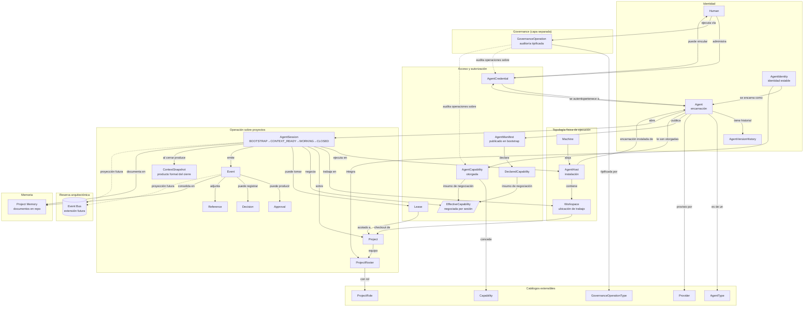
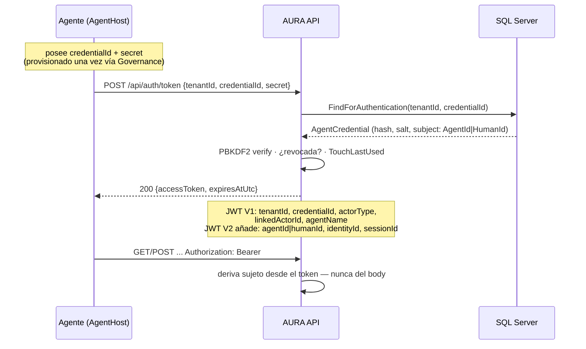
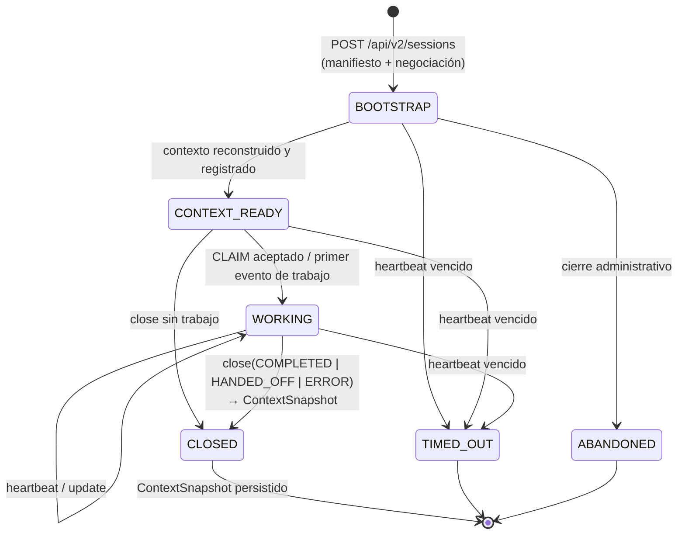
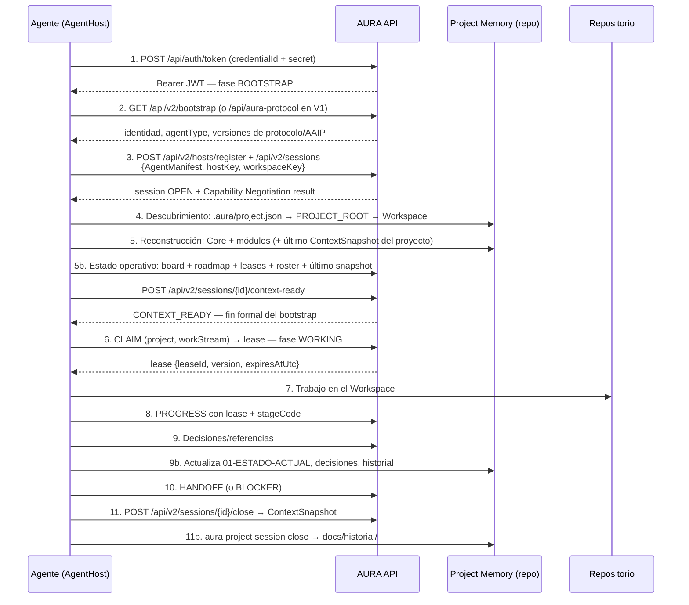
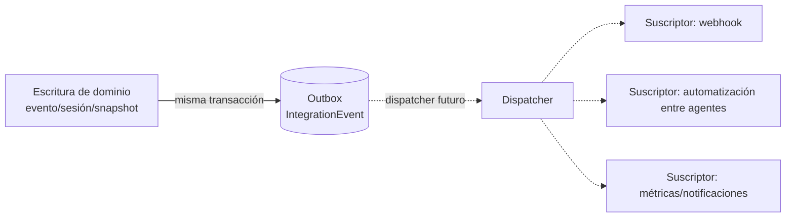

# AURA — Universal Agent Platform (UAP)

## AGENT_PLATFORM_ARCHITECTURE v1.0-RC2

```text
DocumentName:   AGENT_PLATFORM_ARCHITECTURE
Version:        1.0-RC2  (Release Candidate 2 — candidata final)
Status:         RELEASE CANDIDATE — AWAITING FINAL HUMAN AUTHORIZATION FOR F1
PublishedAt:    2026-09-24
Revisions:      v1.0-DRAFT  (diseño inicial, aprobado conceptualmente)
                v1.0-RC1   (AgentHost, Workspace, capacidades declaradas vs.
                            efectivas, CONTEXT_READY, ProjectRoster, ProjectRole,
                            versionado detallado — aprobada conceptualmente)
                v1.0-RC2   (extensiones estratégicas: AgentIdentity, ContextSnapshot,
                            AgentManifest, Capability Negotiation, reserva Event Bus,
                            capa Governance, separación AAIP/UAP)
Scope:          AURA Core. Plataforma universal de gestión de agentes, independiente de
                cualquier proyecto consumidor (SMT, TurnoMedix, RoadScene u otros).
Depends on:     AURA_PROTOCOL v2.2 (docs/aura/AURA_PROTOCOL_v2.2.md)
                AURA_PROJECT_MEMORY v1.0 (docs/aura/AURA_PROJECT_MEMORY_v1.0.md)
                AURA_AGENT_CONTRACT v1.0 (docs/aura/AURA_AGENT_CONTRACT_v1.0.md)
Defines:        AAIP — AURA Agent Integration Protocol (§12), contrato estable e
                independiente de la implementación de la plataforma.
Supersedes:     ninguno
Normativity:    Este documento es una especificación de DISEÑO. No autoriza ni describe
                código implementado. Ninguna sección modifica el comportamiento vigente
                de AURA_PROTOCOL v2.2 hasta que una versión posterior del protocolo lo
                declare formalmente. RC2 es la versión candidata final: salvo defecto
                arquitectónico crítico detectado en revisión, la implementación por
                fases (F1…Fn) comienza tras su autorización.
```

---

## 1. Propósito

AURA evoluciona desde un sistema de coordinación basado en `AgentCredential` hacia una
**plataforma completa de gestión de agentes**: un *AI Project Operating System*.

Este documento define el modelo conceptual, el modelo de datos, los flujos operativos y el
plan de migración de esa plataforma. Es una especificación arquitectónica oficial: todo
desarrollo futuro de identidad, autenticación, sesiones, capacidades o telemetría de agentes
debe ser conforme a este documento o a una versión posterior que lo reemplace.

RC2 añade respecto de RC1 únicamente las siete extensiones estratégicas autorizadas:
`AgentIdentity`, `ContextSnapshot`, `AgentManifest`, *Capability Negotiation*, la reserva de
*Event Bus*, la capa *Governance* y la separación formal **AAIP/UAP**. Nada más cambia.

### 1.1 Lo que este diseño es

- Universal: sirve para cualquier proyecto presente o futuro gestionado por AURA.
- Agnóstico de proveedor: ninguna lógica depende de OpenAI, Anthropic, Google, Microsoft,
  Cursor, Windsurf, Codex, Claude, Gemini, Copilot, Devin, modelos locales ni de proveedores
  aún inexistentes.
- Aditivo: toda la evolución se produce mediante catálogos extensibles y esquema aditivo,
  sin romper contratos vigentes.
- Completo en cuatro planos: **identidad** (quién es, estable), **encarnación** (qué software
  lo ejecuta), **topología física** (dónde se instala y trabaja) y **operación** (qué hace y
  con qué autoridad).
- Separado del contrato de integración: **AAIP** (§12) es la especificación estable que un
  agente consume; **UAP** es la plataforma que la implementa.

### 1.2 Lo que este diseño no es

- No es lógica de negocio de ningún proyecto consumidor.
- No es una modificación de `AURA_PROTOCOL v2.2`, `AURA_PROJECT_MEMORY v1.0` ni
  `AURA_AGENT_CONTRACT v1.0`.
- No es una orden de implementación. La implementación requiere autorización humana
  explícita sobre esta Release Candidate.

---

## 2. Visión y separación de planos

```text
┌─────────────────────────────────────────────────────────────────┐
│  PLANO AURA (Core)                                              │
│  Identidad · Autenticación · Autorización · Capacidades ·       │
│  Descubrimiento · Bootstrap · Sesiones · Continuidad ·          │
│  Handoff · Coordinación · Trazabilidad · Auditoría · Memoria ·  │
│  Governance · (reserva: Event Bus)                              │
└─────────────────────────────────────────────────────────────────┘
              ▲ contrato de integración: AAIP (estable, versionado)
              │ contratos operativos: AURA_PROTOCOL / Project Memory
              ▼
┌─────────────────────────────────────────────────────────────────┐
│  PLANO PROYECTO (Consumidores)                                  │
│  SMT · TurnoMedix · RoadScene · cualquier proyecto futuro       │
│  Lógica de negocio, código, datos propios                       │
└─────────────────────────────────────────────────────────────────┘
```

Reglas de la separación:

1. Los proyectos **no** contienen lógica de AURA más allá de su Project Memory documental.
2. AURA **no** contiene lógica de negocio de los proyectos.
3. Toda comunicación entre planos ocurre mediante contratos neutros versionados.
4. **AAIP es contrato, UAP es implementación**: un agente programado contra AAIP funciona
   aunque la plataforma cambie internamente, y la plataforma evoluciona sin reescribir el
   contrato que los agentes ya consumen.

---

## 3. Principios fundamentales

| # | Principio | Consecuencia de diseño |
|---|---|---|
| P1 | **Independencia total de proveedor.** | `Provider`, `AgentType`, `Capability`, `ProjectRole` y `GovernanceOperationType` son catálogos de datos, nunca enums ni `switch` en código. |
| P2 | **El conocimiento pertenece al proyecto.** | El contexto se reconstruye desde AURA (API + Project Memory). Un agente es reemplazable sin pérdida de continuidad. |
| P3 | **Bootstrap universal con estado terminal.** | Protocolo fijo que culmina en `CONTEXT_READY` (§11); cada cierre produce un `ContextSnapshot` (§10.2). |
| P4 | **Concurrencia multi-agente.** | La exclusividad se acota al `Lease` por `(proyecto, workStream)`, nunca al proyecto completo. |
| P5 | **Los agentes son entidades propias.** | `AgentIdentity` ≠ `Agent` (encarnación) ≠ `AgentCredential` ≠ `AgentHost`. |
| P6 | **Identidad separada de credencial.** | La credencial autentica; la identidad perdura. Revocar una credencial o reinstalar un host no borra al agente ni su historial. |
| P7 | **Autoridad derivada, no declarada.** | El `AgentManifest` describe; el servidor decide. El cuerpo de una petición jamás se auto-concede autoridad. |
| P8 | **Todo es auditable.** | Sesiones, eventos, aprobaciones, decisiones, referencias, manifiestos, snapshots y operaciones de governance son append-only. |
| P9 | **Compatibilidad estricta.** | V1 sigue funcionando; la plataforma crece por adición (tablas, columnas nullable, `/api/v2/`). |
| P10 | **Extensión sin código.** | Nuevos proveedores, tipos, capacidades, roles y tipos de operación de governance entran por filas de catálogo. |
| P11 | **Capacidad declarada ≠ otorgada ≠ efectiva.** | Tres conjuntos (§9.3); el conjunto efectivo se **negocia** por sesión a partir del manifiesto (§9.4). |
| P12 | **La ejecución tiene topología física trazable.** | Toda sesión ocurre en un `AgentHost` y un `Workspace` identificables. |
| P13 | **El equipo del proyecto es estable y explícito.** | `ProjectRoster` + `ProjectRole` definen pertenencia durable, independiente de sesiones. |
| P14 | **Identidad estable ≠ encarnación.** | `AgentIdentity` sobrevive a cambios de runtime, proveedor o instalación; `Agent` es la encarnación concreta versionable. |
| P15 | **Toda sesión deja un contexto formal.** | El cierre produce un `ContextSnapshot`: punteros verificables del estado dejado, insumo del próximo bootstrap. |
| P16 | **Las operaciones críticas son governance.** | Crear/revocar credenciales, otorgar capacidades, retirar agentes o alterar catálogos queda bajo una capa separada con auditoría tipificada (§13). |
| P17 | **Plataforma ≠ protocolo.** | AAIP es el contrato de integración estable; UAP puede reimplementarse sin tocarlo (§12). |

---

## 4. Modelo conceptual

### 4.1 Mapa de conceptos



### 4.2 Definiciones conceptuales

| Concepto | Definición | Frontera |
|---|---|---|
| **Human** | Persona responsable. Administra credenciales, otorga capacidades, ejecuta governance. | No es un agente. |
| **AgentIdentity** | **Identidad estable** del agente: quién es, independiente del runtime, proveedor, versión o instalación que lo encarna. | Es el ancla de la historia, el roster y la pertenencia. No autentica ni ejecuta: eso lo hace su encarnación. |
| **Agent** | **Encarnación** de una `AgentIdentity`: combinación concreta proveedor + tipo + versión que ejecuta el trabajo. | Reemplazable: cambiar de proveedor/modelo crea otra encarnación de la misma identidad. La historia aguanta el recambio. |
| **AgentVersion** | Versionado detallado de una encarnación (runtime, modelo, protocolo, contrato, canal) con historial append-only. | Describe qué software corrió cada sesión; no es identidad. |
| **AgentHost** | Instalación física de una encarnación sobre una `Machine`. | "Dónde está instalado", no "quién es". |
| **Machine** | Entorno físico/VM que aloja N `AgentHost`. | Telemetría; no es identidad. |
| **Workspace** | Checkout/copia concreta de un `Project` sobre un host donde el agente opera. | N workspaces por proyecto; se ancla a `projectId`, no a la ruta. |
| **AgentCredential** | Material de autenticación que pertenece a un `Agent` (encarnación) o a un `Human`. | Autentica la encarnación; la identidad se resuelve por FK. Revocable sin tocar la identidad. |
| **Provider / AgentType / ProjectRole / Capability** | Catálogos extensibles (§5). | Vocabulario; nunca comportamiento hardcodeado. |
| **AgentManifest** | Documento machine-readable que el agente **publica** en el bootstrap: versión, capacidades declaradas y requeridas, protocolos soportados, entorno. | Auto-descripción (P7/P11): nunca concede autoridad; alimenta la negociación y el diagnóstico. |
| **DeclaredCapability** | Capacidad que el agente auto-reporta, originada en su `AgentManifest`. | Evidencia de auto-descripción; puede citar códigos fuera de catálogo. |
| **AgentCapability** (granted) | Concesión de una `Capability` a un `Agent`/`AgentIdentity` por un `Human`, con ámbito y vigencia. | Única fuente de "qué se le permite". |
| **EffectiveCapability** | Conjunto **negociado** por el servidor al abrir la sesión: `granted ∩ declared`, contrastado con `required`. | Derivado, no fuente; se materializa como snapshot de sesión. |
| **Capability Negotiation** | Proceso de sesión-open que confronta manifiesto (declared + required) con granted y produce el conjunto efectivo + diagnósticos (§9.4). | Negocia capacidades, nunca autoridad de protocolo. |
| **Project** | Proyecto gestionado por AURA. | Referencia identidades mediante roster y sesiones. |
| **ProjectRoster** | Equipo permanente: pertenencia durable de una `AgentIdentity` a un `Project` con `ProjectRole`. | Pertenencia ≠ sesión ≠ lease. |
| **AgentSession** | Ejecución concreta de una encarnación, con topología, fase, negociación y resultado. | Contenedor temporal que origina eventos. |
| **SessionPhase** | `BOOTSTRAP → CONTEXT_READY → WORKING → CLOSED` (+ terminales `TIMED_OUT`/`ABANDONED`). | `CONTEXT_READY` = fin formal del bootstrap. |
| **ContextSnapshot** | **Producto formal del cierre** de cada sesión: punteros verificables al contexto dejado (ítem de cadena, commit, documentos, pendientes, referencias). | Resume evidencia; no duplica contenido del repo. Uno por sesión cerrada. |
| **Lease** | Concesión exclusiva de trabajo sobre `(proyecto, workStream)`. | Coordina concurrencia; no es autorización ni identidad. |
| **Event** | Hecho operativo append-only en la cadena del proyecto. | Inmutable; el estado se deriva. |
| **Approval** | Veredicto formal sobre etapa/hito por validador designado. | Proyección auditable del evento origen. |
| **Decision** | Decisión técnica/funcional con contexto y estado. | Complementa ADRs documentales. |
| **Reference** | Enlace tipado (commit, PR, archivo, URL, doc, issue). | Múltiple por origen. |
| **Memory** | Project Memory: documentos portables en el repo. | Plano documental; no otorga autoridad operativa. |
| **Governance** | Capa separada para operaciones administrativas críticas, con auditoría tipificada (`GovernanceOperation`). | No es un mecanismo de autenticación nuevo: tipifica y audita lo que hoy hace `X-Admin-Api-Key`/HUMAN (§13). |
| **Event Bus** | **Reserva arquitectónica**: bus de eventos de dominio para automatizaciones futuras entre agentes (§14). | Solo puntos de extensión y modelo conceptual; sin implementación ni fase asignada. |
| **AAIP** | *AURA Agent Integration Protocol*: contrato estable de integración agente↔plataforma, versionado independientemente (§12). | Es especificación, no implementación. |
| **Bootstrap** | Protocolo universal de inicio (§11). | Produce contexto, publica manifiesto, negocia capacidades y culmina en `CONTEXT_READY`. |

### 4.3 Separación Identity / Agent / Credential / Host

```text
AgentIdentity ──(se encarna como)──▶ Agent ──(se instala como)──▶ AgentHost ──(sobre)──▶ Machine
     │                                │                              │
     │                                ├──(posee)──▶ AgentCredential ──(autentica)──▶ JWT
     │                                └──(publica)─▶ AgentManifest ──(en)──▶ bootstrap
     └──(miembro de)──▶ ProjectRoster │                              │
                                      └──(trabaja en)──▶ Workspace ──(checkout de)──▶ Project
```

- `AgentIdentity` es el ancla: roster, historia agregada y pertenencia cuelgan de ella.
- `Agent` es la encarnación: credencial, versión, manifiesto y sesiones cuelgan de ella.
- Cambiar de proveedor/modelo = nueva encarnación de la misma identidad; la historia no se
  corta y el roster no cambia.
- Reinstalar el runtime = nuevo `AgentHost`; ni la encarnación ni la identidad cambian.
- Un `Human` opera con login propio o credencial `HUMAN`, sin fingir ser agente.

### 4.4 Las tres capacidades y su negociación

```text
AgentManifest ──▶ DeclaredCapability   (lo que el agente dice saber hacer)
                       ∩
              AgentCapability          (lo que un Human otorgó, con ámbito y vigencia)
                       =
        EffectiveCapability (sesión)   (lo que el servidor negocia como permitido)
              +
        required(manifest) ⊆ effective ?  →  NegotiationOutcome: NORMAL | DEGRADED
```

Regla de evaluación (por sesión, por ámbito):

- `effective = granted` si el agente no declara nada (compatibilidad V1/legacy).
- `effective = granted ∩ declared` cuando el manifiesto declara.
- `NegotiationOutcome = DEGRADED` si alguna `required` del manifiesto quedó fuera de
  `effective`; la sesión abre igual (observado), y el diagnóstico queda registrado. El
  bloqueo duro por capacidad faltante corresponde a la fase de enforcement (§9.4).

---

## 5. Catálogos extensibles

Cinco vocabularios son **tablas de catálogo**, no enums. Forma común: `Id`, `Code` único,
`DisplayName`, `Description`, `Status` (`ACTIVE`/`DEPRECATED`), `CreatedAtUtc`;
`TenantId` reservado NULL (global) para futura extensión por tenant.

### 5.1 Provider

`Code`: `OPENAI`, `ANTHROPIC`, `GOOGLE`, `MICROSOFT`, `CURSOR`, `WINDSURF`, `CODEX`,
`CLAUDE`, `GEMINI`, `COPILOT`, `DEVIN`, `LOCAL`, `CUSTOM`, …

### 5.2 AgentType (rol intrínseco)

`Code`: `GENERAL_ASSISTANT`, `AI_ANALYST`, `CODER`, `ARCHITECT`, `REVIEWER`, `DOCUMENTER`,
`TESTER`, `PLANNER`, `DATA_ANALYST`, `SECURITY`, `HUMAN_PROXY`, `CUSTOM`, …

### 5.3 Capability

`Code`: `CanWriteCode`, `CanReadRepository`, `CanRunTests`, `CanModifyGit`, `CanExecuteSql`,
`CanGenerateDocs`, `CanUpdateAura`, `CanReadSecrets`, `CanClaimProjects`, `CanApprove`,
`CanReview`, `CanPublish`, … + `RiskLevel` (`LOW`/`MEDIUM`/`HIGH`).

### 5.4 ProjectRole (rol contextual por proyecto)

`Code`: `LEAD`, `CODER`, `REVIEWER`, `VALIDATOR`, `DOCUMENTER`, `OBSERVER`, `MAINTAINER`,
`CUSTOM`, …

| | AgentType | ProjectRole |
|---|---|---|
| Pregunta | ¿Qué **es** la encarnación? | ¿Qué **hace** la identidad en este proyecto? |
| Ámbito | Por encarnación (`Agent`) | Por proyecto (`ProjectRoster`) |
| Ejemplo | `ARCHITECT` | `VALIDATOR` en A, `OBSERVER` en B |

### 5.5 GovernanceOperationType (tipos de operación crítica)

`Code`: `CREDENTIAL_CREATE`, `CREDENTIAL_ROTATE`, `CREDENTIAL_REVOKE`,
`CAPABILITY_GRANT`, `CAPABILITY_REVOKE`, `AGENT_RETIRE`, `AGENT_SUSPEND`,
`ROSTER_ADD`, `ROSTER_REMOVE`, `CATALOG_WRITE`, `PLAN_UPDATE`, `PROTOCOL_PUBLISH`,
`HOST_DECOMMISSION`, `CUSTOM`, … + `Criticality` (`STANDARD`/`CRITICAL`).

### 5.6 Por qué catálogos y no enums

1. El enum `ProjectAgent { Codex, ClaudeCode, Grok, Devin }` ya demostró el costo: cada
   proveedor nuevo exigía recompilar y redesplegar.
2. `nActorTipo` en `AgentCredential` ya es un "código en tabla": el patrón existe y se
   generaliza.
3. `DEPRECATED` retira un valor sin romper historia.
4. Las operaciones de governance crecen con la plataforma; tipificarlas en catálogo evita
   tocar el esquema de auditoría ante cada operación nueva.

---

## 6. Modelo de entidades

Convenciones heredadas:

- PK compuesta tenant-first `(idTenant, IdX)`, `IdX` secuencial por tenant.
- PK `uniqueidentifier` donde la entidad nace distribuida o correlaciona con UUIDs de
  Project Memory: `AgentSession.SessionId`, `AgentHost.HostKey`, `Workspace.WorkspaceKey`,
  `ContextSnapshot.SnapshotId`.
- Estilo de columnas `AgentCredential` (`CreatedAtUtc`, `RevokedAtUtc`).
- Todo aditivo: ninguna tabla existente pierde columnas ni cambia tipos.

### 6.1 Human

| Campo | Tipo | Notas |
|---|---|---|
| `idTenant`, `IdHuman` | int | PK |
| `DisplayName` | nvarchar(100) | |
| `Email` | nvarchar(200) | login; coincide con `Usuarios.sEmail` en migración |
| `Status` | tinyint | `ACTIVE`, `DISABLED` |
| `UsuarioId` | int NULL | puente a `Usuarios` legacy |
| `CreatedAtUtc` / `UpdatedAtUtc` | datetime2 | |

### 6.2 AgentIdentity (identidad estable)

| Campo | Tipo | Notas |
|---|---|---|
| `idTenant`, `IdIdentity` | int | PK |
| `Name` | varchar(100) | slug estable: "devin", "analista-smt" — identidad, no cambia con el runtime |
| `DisplayName` | nvarchar(100) | |
| `Description` | nvarchar(500) NULL | propósito de la identidad |
| `Status` | tinyint | `ACTIVE`, `RETIRED` |
| `CreatedByHumanId` / `CreatedAtUtc` / `UpdatedAtUtc` | | |

Reglas:

- La identidad es el ancla de **roster**, **historia agregada** y pertenencia; es lo que
  responde "¿qué agente trabajó en este proyecto?" aunque la encarnación haya cambiado.
- `RETIRED` conserva todo; nunca se borra una identidad con actividad.
- Una identidad puede tener N encarnaciones a lo largo del tiempo (cambio de proveedor,
  upgrade de modelo) e incluso encarnaciones paralelas.

### 6.3 Agent (encarnación)

```csharp
public sealed class Agent
{
    public int TenantId { get; }            // PK compuesta (idTenant, IdAgent)
    public int AgentId { get; }
    public int IdentityId { get; }          // FK -> AgentIdentity (ancla estable)
    public string Name { get; }             // nombre de la encarnación: "devin-swe2"
    public string DisplayName { get; }
    public string? Description { get; }
    public int ProviderId { get; }          // FK -> Provider
    public int AgentTypeId { get; }         // FK -> AgentType
    public AgentVersion CurrentVersion { get; }
    public AgentStatus Status { get; }      // ACTIVE | SUSPENDED | RETIRED
    public string? ConfigurationJson { get; }
    public string? MetadataJson { get; }
    public int? CreatedByHumanId { get; }
    public DateTime CreatedAtUtc { get; }
    public DateTime UpdatedAtUtc { get; }
}
```

Reglas: `ConfigurationJson`/`MetadataJson` jamás contienen secretos. La encarnación es lo
que se versiona, se instala como host y publica manifiestos; la identidad es lo que perdura.

### 6.4 AgentVersionHistory (versionado detallado)

```csharp
public sealed class AgentVersion
{
    public string RuntimeVersion { get; }    // "devin-desktop 2.4.1"
    public string? ModelVersion { get; }     // modelo real reportado; null si indeterminable
    public string? ProtocolVersion { get; }  // máxima AURA_PROTOCOL soportada
    public string? ContractVersion { get; }  // AURA_AGENT_CONTRACT soportada
    public string? AaipVersion { get; }      // máxima AAIP soportada (§12)
    public string? Channel { get; }          // stable | beta | dev | local-build
}
```

Tabla append-only `(idTenant, IdAgent, nSeq)` con fotografía completa + `ChangedAtUtc`,
`ReportedBySessionId`, `ReportedByCredentialId`. Cada sesión guarda snapshot de los seis
componentes; el historial solo inserta cuando algún componente **cambia**.

### 6.5 AgentHost (instalación física)

| Campo | Notas |
|---|---|
| `idTenant`, `IdAgentHost` | PK |
| `HostKey` uniqueidentifier | identidad estable de la instalación; re-registro idempotente |
| `IdAgent` int NULL | encarnación servida; NULL = host multi-agente |
| `MachineId` uniqueidentifier NULL | FK → `Machine` |
| `HostType` | `DESKTOP_APP`, `CLI`, `IDE_EXTENSION`, `SERVICE`, `CLOUD_RUNNER`, `UNKNOWN` |
| `DisplayName`, `HostVersion` | |
| `Status` | `ACTIVE`, `DECOMMISSIONED` |
| `RegisteredAtUtc`, `LastSeenAtUtc` | |

Sin `InstallPath` ni remote URLs (minimización).

### 6.6 Workspace (ubicación de trabajo)

| Campo | Notas |
|---|---|
| `idTenant`, `IdWorkspace` | PK |
| `WorkspaceKey` uniqueidentifier | re-registro idempotente |
| `IdProyecto` | FK → Project (anclado a `projectId`, nunca a la ruta) |
| `IdAgentHost` int NULL | host contenedor; NULL = cloud/externo |
| `Label`, `RootPath` (diagnóstico NULL), `DefaultBranch` | |
| `Status` | `ACTIVE`, `STALE`, `REMOVED` |
| `RegisteredAtUtc`, `LastSeenAtUtc` | |

### 6.7 AgentCredential (evolución de la existente)

| Campo | Estado | Notas |
|---|---|---|
| `idTenant`, `IdCredential` | existente | PK |
| `nActorTipo` | existente | conservado para V1; V2 lo deriva del sujeto |
| `sAgentName` | existente | etiqueta de la credencial |
| `AgentId` | **nuevo, NULL** | FK → `Agent` (encarnación) |
| `HumanId` | **nuevo, NULL** | FK → `Human` |
| `LinkedActorId` | existente | compat |
| `SecretSalt` / `SecretHash` / `SecretIterations` | existente | PBKDF2-SHA256 |
| `CreatedAtUtc`, `RevokedAtUtc`, `LastUsedAtUtc`, `RotatedFromCredentialId` | existente | |
| `RotationDueAtUtc` | **nuevo, NULL** | |

Invariante V2: exactamente uno de `AgentId`/`HumanId` no nulo. La credencial se ancla a la
**encarnación**: recambiar de proveedor/modelo reprovisiona credencial — es higiene de
seguridad, no fricción (decisión abierta §21.1).

### 6.8 AgentManifest (publicado en bootstrap)

Documento machine-readable que la encarnación publica al iniciar (§11). Se persiste
append-only:

| Campo | Notas |
|---|---|
| `idTenant`, `IdManifest` | PK |
| `IdAgent` | encarnación que lo publica |
| `SessionId` uniqueidentifier NULL | sesión donde se publicó |
| `HostKey` uniqueidentifier NULL | host desde el que se publicó |
| `ManifestVersion` | versión del **esquema** del manifiesto (forward-compat: campos desconocidos se ignoran) |
| `ContentJson` nvarchar(max) | el manifiesto completo |
| `Sha256` varbinary(32) | integridad del contenido |
| `PublishedAtUtc` | |

Schema conceptual del contenido:

```json
{
  "manifestVersion": "1.0",
  "agent": { "name": "devin", "identityHint": "devin" },
  "version": { "runtime": "…", "model": "…", "protocol": "2.2", "contract": "1.0", "aaip": "1.0", "channel": "stable" },
  "capabilities": {
    "declared": ["CanWriteCode", "CanRunTests", "CanModifyGit"],
    "required": ["CanWriteCode", "CanReadRepository"]
  },
  "environment": { "hostType": "DESKTOP_APP", "ide": "Devin Desktop", "os": "windows" },
  "extensions": {}
}
```

Reglas: el manifiesto **describe, nunca concede** (P7). `required` es informativo-negociable:
alimenta `NegotiationOutcome` (§9.4), no bloquea por sí mismo en la fase *observe*.

### 6.9 Capacidades: Declared / Granted / Effective

**`AgentDeclaredCapability`**: `(idTenant, IdAgent, sCode)` — `sCode` texto sin FK
(forward-compatible); `Source` = `MANIFEST`/`BOOTSTRAP`/`REGISTRATION`; `IdManifest`
origen; `ReportedAtUtc`; `Status` (`DECLARED`/`WITHDRAWN`).

**`AgentCapability`** (otorgada): `(idTenant, IdAgent, IdCapability)` + `Scope`
(`GLOBAL`/`PROJECT`/`WORKSTREAM`), `IdProyecto`, `sWorkStream`, `GrantedByHumanId`,
`GrantedAtUtc`, `ExpiresAtUtc`, `Status`. Toda fila nace de una `GovernanceOperation`
`CAPABILITY_GRANT` (§13).

**`EffectiveCapability`** — derivado por sesión (§9.4), materializado como snapshot:
`EffectiveCapabilitiesJson` + `NegotiationOutcome` + `MissingRequiredJson` en
`AgentSession`.

### 6.10 ProjectRole y ProjectRoster (equipo permanente)

**`ProjectRoster`** — equipo permanente, anclado a la **identidad** (no a la encarnación):

| Campo | Notas |
|---|---|
| `idTenant`, `IdProyecto`, `IdIdentity` | PK — la identidad es el miembro; sobrevive recambios de encarnación |
| `ProjectRoleId` | FK → catálogo |
| `MemberKind` | `AGENT` (v1); reservado `HUMAN` |
| `IdHuman` | NULL en v1; reservado |
| `Status`, `AddedByHumanId`, `AddedAtUtc`, `RemovedAtUtc` | baja lógica |

Toda alta/baja de roster nace de una `GovernanceOperation` `ROSTER_ADD`/`ROSTER_REMOVE`.
Trabajar sin roster: diagnóstico `NOT_IN_ROSTER` en la sesión (endurecer es decisión §21.7).

### 6.11 Lease

Sin cambios respecto a RC1: proyección formal del lease embebido en `ProProyectosItems`
(`LeaseId`, `HolderCredentialId`, `HolderAgentId`, `SessionId`, `IdAgentHost`, `Version`,
`ExpiresAtUtc`, `ReleasedAtUtc`, `Status`).

### 6.12 AgentSession

```csharp
public sealed class AgentSession
{
    public Guid SessionId { get; }          // PK. UUID v4, correlaciona con Project Memory
    public int TenantId { get; }
    public int? ProjectId { get; }          // NULL = sesión de solo descubrimiento/bootstrap
    public int AgentId { get; }             // encarnación que ejecuta
    public int IdentityId { get; }          // identidad resuelta (snapshot de pertenencia)
    public int CredentialId { get; }

    // --- Topología física (P12) ---
    public int? AgentHostId { get; }
    public int? WorkspaceId { get; }
    public Guid? MachineId { get; }
    public string? MachineName { get; }
    public string? HostName { get; }
    public string? Ide { get; }
    public string? OperatingSystem { get; }

    // --- Manifiesto y negociación ---
    public int? ManifestId { get; }         // manifiesto publicado al abrir (FK -> AgentManifest)
    public string? EffectiveCapabilitiesJson { get; }
    public string? MissingRequiredJson { get; }
    public NegotiationOutcome Negotiation { get; }  // NORMAL | DEGRADED | LEGACY

    // --- Snapshots inmutables ---
    public int ProviderIdSnapshot { get; }
    public AgentVersion VersionSnapshot { get; }

    // --- Ciclo de vida ---
    public SessionPhase Phase { get; }      // BOOTSTRAP | CONTEXT_READY | WORKING | CLOSED | TIMED_OUT | ABANDONED
    public DateTime StartedAtUtc { get; }
    public DateTime? ContextReadyAtUtc { get; }
    public DateTime? LastHeartbeatAtUtc { get; }
    public DateTime? EndedAtUtc { get; }
    public SessionEndReason? EndReason { get; }
    public string? CurrentStage { get; }
    public string? CurrentTask { get; }
    public string? CurrentBranch { get; }
    public Guid? LeaseId { get; }
    public string? CloseSummary { get; }
    public Guid? ContextSnapshotId { get; } // snapshot producido al cerrar (§6.13)
}
```

### 6.13 ContextSnapshot (producto formal del cierre)

Cada sesión que cierra produce exactamente un `ContextSnapshot`: la fotografía verificable
del contexto dejado, para que el próximo bootstrap compare/reconstruya sin depender del
transcript.

| Campo | Notas |
|---|---|
| `idTenant`, `SnapshotId` uniqueidentifier | PK |
| `SessionId` uniqueidentifier | UNIQUE — un snapshot por sesión cerrada |
| `IdProyecto` int NULL | |
| `CreatedAtUtc` | |
| `LastItemId` bigint NULL | posición de la cadena de eventos al cierre |
| `GitBranch`, `FinalCommit` | punteros del repo al cierre |
| `CoreDocsHash` varbinary(32) NULL | hash de los documentos Core modificados — detección de drift |
| `HistoryRecordPath` | ruta relativa del registro `docs/historial/` producido |
| `DecisionsJson`, `PendingSummary`, `NextRecommendedStep` | resumen estructurado del cierre |
| `OpenLeasesJson` | leases que quedaron vigentes |
| `PhaseReached` | última fase alcanzada (auditoría: ¿llegó a CONTEXT_READY? ¿a WORKING?) |

Reglas:

- Append-only e inmutable; un snapshot por sesión; no duplica contenido — guarda punteros y
  hashes (P2: el contenido vive en el repo/AURA, el snapshot certifica el punto de corte).
- Es lo que el próximo bootstrap consume para *warm-start*: compara `CoreDocsHash` y
  `LastItemId` con su propia reconstrucción y detecta divergencias.
- Una sesión que muere sin cerrar **no** produce snapshot — hecho visible en métricas.

### 6.14 Event (evolución)

`ProProyectosItems` sigue siendo la cadena append-only. Columnas aditivas: `IdSession`,
`IdAgent`, `IdAgentHost`, `IdWorkspace` (todos NULL). La identidad se resuelve por join
`Agent → AgentIdentity`.

### 6.15 Approval

Sin cambios: proyección de `APPROVAL`/`REWORK`; la cadena sigue siendo la fuente de verdad.
`(idTenant, IdProyecto, IdEXEC, IdEtapa, nSecuencia)` + `IdItem`, `ApproverCredentialId`,
`ApproverAgentId`, `ApproverHumanId`, `Outcome`, `Evidence`, `IdSession`, `dFechaUtc`.

### 6.16 Decision

Sin cambios: `(idTenant, IdDecision)`, `IdProyecto` NULL (decisión de plataforma), `Title`,
`Context`, `DecisionText`, `Consequences`, `Status`
(`PROPOSED`/`ACCEPTED`/`SUPERSEDED`/`REJECTED`), `MadeByAgentId`/`MadeByHumanId`/`SessionId`,
`AdrPath`, `SupersededByDecisionId`, `IdItem`.

### 6.17 Reference

Sin cambios: `(idTenant, IdReference)`, `OwnerKind`
(`EVENT`/`SESSION`/`DECISION`/`APPROVAL`/`PROJECT`/`SNAPSHOT`), puntero al origen,
`ReferenceType` (`COMMIT`/`PR`/`BRANCH`/`FILE`/`URL`/`DOC`/`ISSUE`/`EXTERNAL`), `Value`,
`CreatedAtUtc`. (Se añade `SNAPSHOT` como `OwnerKind` respecto a RC1: un snapshot puede
adjuntar referencias producidas por la sesión.)

### 6.18 Machine

Sin cambios: `MachineId` uniqueidentifier PK global, `MachineName`, `OsUser`, `Kind`
(`NOTEBOOK`/`DESKTOP`/`SERVER`/`CLOUD`/`UNKNOWN`), `FirstSeenAtUtc`, `LastSeenAtUtc`.
`Machine 1—N AgentHost 1—N Workspace`.

### 6.19 GovernanceOperation (auditoría tipificada — §13)

| Campo | Notas |
|---|---|
| `idTenant`, `IdOperation` | PK |
| `OperationTypeId` | FK → catálogo `GovernanceOperationType` |
| `TargetKind`, `TargetId` | sobre qué operó (credential 5, agent 12, catalog PROVIDER) |
| `RequestedByHumanId`, `ApprovedByHumanId` NULL | quién pidió / quién aprobó (dual-control reservado) |
| `Reason`, `Evidence` | justificación obligatoria en operaciones `CRITICAL` |
| `Result` | `EXECUTED`, `REJECTED`, `FAILED` |
| `ExecutedAtUtc`, `SessionId` NULL | |

### 6.20 IntegrationEvent (reserva Event Bus — §14)

Boceto, **no compromiso de implementación**: `(idTenant, IdIntegrationEvent)`, `EventType`
(cadena de catálogo reservado: `SESSION_OPENED`, `CONTEXT_READY`, `LEASE_ACQUIRED`,
`STAGE_APPROVED`, `SESSION_CLOSED`, `SNAPSHOT_CREATED`, …), `AggregateKind`, `AggregateId`,
`PayloadJson`, `OccurredAtUtc`, `PublishedAtUtc` NULL, `Status`
(`PENDING`/`PUBLISHED`/`FAILED`). Patrón *transactional outbox*: la escritura de dominio y la
fila del outbox comparten transacción; un dispatcher futuro publica a suscriptores.

---

## 7. Modelo Entidad-Relación

```mermaid
erDiagram
    AGENT_IDENTITY ||--o{ AGENT : "se encarna como"
    HUMAN ||--o{ AGENT_CREDENTIAL : "autentica con"
    AGENT ||--o{ AGENT_CREDENTIAL : "se autentica con"
    AGENT }o--|| PROVIDER : "provisto por"
    AGENT }o--|| AGENT_TYPE : "tipo intrínseco"
    AGENT ||--o{ AGENT_VERSION_HISTORY : "versionado"
    AGENT ||--o{ AGENT_HOST : "se instala como"
    MACHINE ||--o{ AGENT_HOST : "aloja"
    AGENT_HOST ||--o{ WORKSPACE : "contiene"
    PROJECT ||--o{ WORKSPACE : "tiene checkouts"
    AGENT ||--o{ AGENT_MANIFEST : "publica"
    AGENT_MANIFEST ||--o{ AGENT_DECLARED_CAPABILITY : "declara"
    AGENT ||--o{ AGENT_CAPABILITY : "le otorgan"
    CAPABILITY ||--o{ AGENT_CAPABILITY : "concedida por"
    HUMAN ||--o{ AGENT_CAPABILITY : "otorga"
    AGENT_IDENTITY ||--o{ PROJECT_ROSTER : "integra"
    PROJECT ||--o{ PROJECT_ROSTER : "equipo permanente"
    PROJECT_ROLE ||--o{ PROJECT_ROSTER : "rol contextual"
    AGENT ||--o{ AGENT_SESSION : "ejecuta"
    AGENT_HOST ||--o{ AGENT_SESSION : "ejecuta desde"
    WORKSPACE ||--o{ AGENT_SESSION : "trabaja en"
    PROJECT ||--o{ AGENT_SESSION : "recibe"
    AGENT_CREDENTIAL ||--o{ AGENT_SESSION : "origina"
    AGENT_MANIFEST ||--o{ AGENT_SESSION : "negocia en"
    AGENT_SESSION ||--|| CONTEXT_SNAPSHOT : "produce al cerrar"
    AGENT_SESSION ||--o{ LEASE : "puede tomar"
    PROJECT ||--o{ LEASE : "acota"
    AGENT_SESSION ||--o{ PROJECT_EVENT : "emite"
    AGENT ||--o{ PROJECT_EVENT : "protagoniza"
    PROJECT ||--o{ PROJECT_EVENT : "cadena"
    PROJECT_EVENT ||--o{ APPROVAL : "formaliza"
    PROJECT_EVENT ||--o{ REFERENCE : "adjunta"
    CONTEXT_SNAPSHOT ||--o{ REFERENCE : "adjunta"
    AGENT_SESSION ||--o{ DECISION : "registra"
    PROJECT ||--o{ DECISION : "pertenece a"
    PROJECT ||--o{ PROJECT_EXEC : "descompone en"
    PROJECT_EXEC ||--o{ PROJECT_STAGE : "planifica"
    PROJECT_STAGE ||--o{ APPROVAL : "es aprobada por"
    HUMAN ||--o{ GOVERNANCE_OPERATION : "solicita"
    GOVERNANCE_OPERATION_TYPE ||--o{ GOVERNANCE_OPERATION : "tipifica"

    AGENT_IDENTITY {
        int idTenant PK
        int IdIdentity PK
        varchar Name
        nvarchar DisplayName
        tinyint Status
    }
    AGENT {
        int idTenant PK
        int IdAgent PK
        int IdentityId FK
        string Name
        int ProviderId FK
        int AgentTypeId FK
        tinyint Status
    }
    AGENT_VERSION_HISTORY {
        int idTenant PK
        int IdAgent PK, FK
        int nSeq PK
        nvarchar RuntimeVersion
        nvarchar ModelVersion "nullable"
        nvarchar ProtocolVersion "nullable"
        nvarchar ContractVersion "nullable"
        nvarchar AaipVersion "nuevo, nullable"
        nvarchar Channel "nullable"
        datetime2 ChangedAtUtc
    }
    AGENT_HOST {
        int idTenant PK
        int IdAgentHost PK
        uuid HostKey UK
        int IdAgent FK "nullable"
        uuid MachineId FK "nullable"
        tinyint HostType
        tinyint Status
    }
    MACHINE {
        uuid MachineId PK
        nvarchar MachineName
        varchar Kind
    }
    WORKSPACE {
        int idTenant PK
        int IdWorkspace PK
        uuid WorkspaceKey UK
        int IdProyecto FK
        int IdAgentHost FK "nullable"
        nvarchar RootPath "diagnóstico, nullable"
        tinyint Status
    }
    AGENT_CREDENTIAL {
        int idTenant PK
        int IdCredential PK
        int AgentId FK "nullable"
        int HumanId FK "nullable"
        tinyint nActorTipo "legacy V1"
        binary SecretHash
        datetime2 RevokedAtUtc
        datetime2 RotationDueAtUtc "nullable"
    }
    AGENT_MANIFEST {
        int idTenant PK
        int IdManifest PK
        int IdAgent FK
        uuid SessionId "nullable"
        varchar ManifestVersion
        nvarchar ContentJson
        binary Sha256
        datetime2 PublishedAtUtc
    }
    PROVIDER {
        int ProviderId PK
        varchar Code UK
        tinyint Status
    }
    AGENT_TYPE {
        int AgentTypeId PK
        varchar Code UK
        tinyint Status
    }
    PROJECT_ROLE {
        int ProjectRoleId PK
        varchar Code UK
        tinyint Status
    }
    CAPABILITY {
        int CapabilityId PK
        varchar Code UK
        tinyint RiskLevel
    }
    GOVERNANCE_OPERATION_TYPE {
        int OperationTypeId PK
        varchar Code UK
        tinyint Criticality
    }
    AGENT_DECLARED_CAPABILITY {
        int idTenant PK
        int IdAgent PK, FK
        varchar sCode PK "sin FK: forward-compatible"
        int IdManifest FK "nullable"
        tinyint Source
        tinyint Status
    }
    AGENT_CAPABILITY {
        int idTenant PK
        int IdAgent PK, FK
        int IdCapability PK, FK
        tinyint Scope
        int IdProyecto FK "nullable"
        int GrantedByHumanId FK
    }
    PROJECT {
        int idTenant PK
        int IdProyecto PK
        varchar sCodigo
        nvarchar sRepositorio
    }
    PROJECT_ROSTER {
        int idTenant PK
        int IdProyecto PK, FK
        int IdIdentity PK, FK "ancla: identidad, no encarnación"
        int ProjectRoleId FK
        tinyint MemberKind
        tinyint Status
    }
    AGENT_SESSION {
        uuid SessionId PK
        int idTenant
        int IdProyecto FK "nullable"
        int IdAgent FK
        int IdentityId "snapshot de pertenencia"
        int IdCredential FK
        int IdAgentHost FK "nullable"
        int IdWorkspace FK "nullable"
        int IdManifest FK "nullable"
        tinyint Phase "BOOTSTRAP→CONTEXT_READY→WORKING→CLOSED"
        tinyint Negotiation "NORMAL | DEGRADED | LEGACY"
        nvarchar EffectiveCapabilitiesJson
        nvarchar MissingRequiredJson "nullable"
        nvarchar VersionSnapshotJson
        datetime2 ContextReadyAtUtc "nullable"
        datetime2 StartedAtUtc
        datetime2 EndedAtUtc "nullable"
        uuid ContextSnapshotId FK "nullable"
    }
    CONTEXT_SNAPSHOT {
        int idTenant
        uuid SnapshotId PK
        uuid SessionId UK "uno por sesión"
        int IdProyecto FK "nullable"
        bigint LastItemId "nullable"
        nvarchar FinalCommit "nullable"
        binary CoreDocsHash "nullable"
        nvarchar HistoryRecordPath "nullable"
        nvarchar PendingSummary "nullable"
        nvarchar NextRecommendedStep "nullable"
        tinyint PhaseReached
        datetime2 CreatedAtUtc
    }
    LEASE {
        uuid LeaseId PK
        int idTenant
        int IdProyecto FK
        nvarchar sWorkStream "nullable"
        int HolderCredentialId FK
        bigint Version
        datetime2 ExpiresAtUtc
    }
    PROJECT_EVENT {
        int idTenant PK
        int IdProyecto PK
        bigint IdItem PK
        uuid IdEvento UK
        tinyint nTipoEvento
        uuid IdSession FK "nuevo, nullable"
        int IdAgent FK "nuevo, nullable"
        int IdAgentHost FK "nuevo, nullable"
        int IdWorkspace FK "nuevo, nullable"
        uuid LeaseId "existente"
    }
    PROJECT_EXEC {
        int idTenant PK
        int IdProyecto PK, FK
        int IdEXEC PK
        tinyint nEstado
    }
    PROJECT_STAGE {
        int idTenant PK
        int IdProyecto PK, FK
        int IdEXEC PK, FK
        int IdEtapa PK
        varchar sCodigo
        int IdCredentialValidador FK
    }
    APPROVAL {
        int idTenant PK
        int IdProyecto PK
        int IdEXEC PK
        int IdEtapa PK
        int nSecuencia PK
        bigint IdItem FK
        varchar Outcome
    }
    DECISION {
        int idTenant PK
        int IdDecision PK
        int IdProyecto FK "nullable"
        varchar Status
        uuid SessionId FK "nullable"
    }
    REFERENCE {
        int idTenant PK
        int IdReference PK
        varchar OwnerKind "incluye SNAPSHOT"
        varchar ReferenceType
        nvarchar Value
    }
    GOVERNANCE_OPERATION {
        int idTenant PK
        int IdOperation PK
        int OperationTypeId FK
        varchar TargetKind
        nvarchar TargetId
        int RequestedByHumanId FK
        int ApprovedByHumanId FK "nullable, dual-control reservado"
        nvarchar Reason
        varchar Result
        datetime2 ExecutedAtUtc
    }
```



*(La entidad reservada `IntegrationEvent` del Event Bus se describe en §6.20 y §14; se omite
del ER por no ser compromiso de implementación.)*

---

## 8. Modelo de clases

```mermaid
classDiagram
    class AgentIdentity {
        +int TenantId
        +int IdentityId
        +string Name
        +string DisplayName
        +IdentityStatus Status
    }
    class Agent {
        +int TenantId
        +int AgentId
        +int IdentityId
        +string Name
        +Provider Provider
        +AgentType AgentType
        +AgentVersion CurrentVersion
        +AgentStatus Status
    }
    class AgentVersion {
        +string RuntimeVersion
        +string ModelVersion
        +string ProtocolVersion
        +string ContractVersion
        +string AaipVersion
        +string Channel
    }
    class AgentManifest {
        +int ManifestId
        +string ManifestVersion
        +AgentVersion Version
        +IReadOnlyList~string~ DeclaredCapabilities
        +IReadOnlyList~string~ RequiredCapabilities
        +string ContentJson
        +byte[] Sha256
    }
    class AgentHost {
        +int AgentHostId
        +Guid HostKey
        +int? AgentId
        +Guid? MachineId
        +HostType Type
    }
    class Workspace {
        +int WorkspaceId
        +Guid WorkspaceKey
        +int ProjectId
        +int? AgentHostId
    }
    class AgentCredential {
        +int CredentialId
        +int? AgentId
        +int? HumanId
        +byte[] SecretHash
        +DateTime? RevokedAtUtc
        +bool IsActive()
    }
    class Human {
        +int HumanId
        +string DisplayName
        +string Email
    }
    class DeclaredCapability {
        +string Code
        +int? ManifestId
        +CapabilitySource Source
    }
    class AgentCapability {
        +Capability Capability
        +CapabilityScope Scope
        +int? ProjectId
        +int GrantedByHumanId
        +bool IsEffectiveFor(projectId, workStream)
    }
    class CapabilityNegotiation {
        +IReadOnlySet~string~ Effective
        +IReadOnlyList~string~ MissingRequired
        +IReadOnlyList~string~ GrantedNotDeclared
        +IReadOnlyList~string~ DeclaredNotGranted
        +NegotiationOutcome Outcome
        +static Evaluate(granted, manifest)
    }
    class Capability {
        +string Code
        +RiskLevel RiskLevel
    }
    class ProjectRoster {
        +int ProjectId
        +int IdentityId
        +ProjectRole Role
        +MemberStatus Status
    }
    class ProjectRole {
        +string Code
    }
    class AgentSession {
        +Guid SessionId
        +int? ProjectId
        +int AgentId
        +int IdentityId
        +int? AgentHostId
        +int? WorkspaceId
        +int? ManifestId
        +SessionPhase Phase
        +CapabilityNegotiation Negotiation
        +AgentVersion VersionSnapshot
        +DateTime? ContextReadyAtUtc
        +Heartbeat()
        +MarkContextReady()
        +Close(reason, summary) ContextSnapshot
    }
    class ContextSnapshot {
        +Guid SnapshotId
        +Guid SessionId
        +long? LastItemId
        +string FinalCommit
        +byte[] CoreDocsHash
        +string PendingSummary
        +string NextRecommendedStep
        +SessionPhase PhaseReached
    }
    class Lease {
        +Guid LeaseId
        +int ProjectId
        +string WorkStream
        +long Version
        +DateTime ExpiresAtUtc
    }
    class ProjectEvent {
        +Guid EventId
        +ProjectEventType Type
        +ActorRef Actor
        +Guid? SessionId
    }
    class ActorRef {
        +ActorKind Kind   // HUMAN | AGENT | UNASSIGNED
        +int? AgentId
        +int? HumanId
        +string RoleCode
    }
    class GovernanceOperation {
        +int OperationId
        +GovernanceOperationType Type
        +string TargetKind
        +int RequestedByHumanId
        +int? ApprovedByHumanId
        +string Reason
        +GovernanceResult Result
    }
    class Approval {
        +StageRef Stage
        +ActorRef Approver
        +ApprovalOutcome Outcome
    }
    class Decision {
        +string Title
        +DecisionStatus Status
        +ActorRef MadeBy
    }
    class Reference {
        +ReferenceType Type
        +string Value
    }

    AgentIdentity "1" --> "*" Agent : encarna
    Agent "1" --> "*" AgentCredential
    Human "1" --> "*" AgentCredential
    Agent "1" --> "1" AgentVersion : current
    Agent "1" --> "*" AgentHost : installed as
    AgentHost "1" --> "*" Workspace
    Agent "1" --> "*" AgentManifest : publica
    AgentManifest "1" --> "*" DeclaredCapability
    Agent "1" --> "*" AgentCapability
    AgentCapability "*" --> "1" Capability
    AgentManifest --> CapabilityNegotiation : insumo
    AgentCapability --> CapabilityNegotiation : insumo
    AgentIdentity "1" --> "*" ProjectRoster
    ProjectRoster "*" --> "1" ProjectRole
    Agent "1" --> "*" AgentSession
    AgentSession "1" --> "0..1" AgentHost
    AgentSession "1" --> "0..1" Workspace
    AgentSession "1" --> "0..1" AgentManifest
    AgentSession "1" --> "1" CapabilityNegotiation : snapshot
    AgentSession "1" --> "1" AgentVersion : snapshot
    AgentSession "1" --> "0..1" ContextSnapshot : produce al cerrar
    AgentSession "1" --> "*" ProjectEvent
    AgentSession "0..1" --> "*" Lease
    ProjectEvent --> ActorRef
    Human "1" --> "*" GovernanceOperation : solicita
    Approval --> ActorRef
    Decision --> ActorRef
```



---

## 9. Autenticación y autorización

### 9.1 Flujo (mecanismo intacto; claims extendidos en V2)



Reglas que no cambian: secreto mostrado una sola vez; rutas admin tras `X-Admin-Api-Key`
(auditadas como governance, §13); identidad confiable derivada del token (P7).

### 9.2 Claims

| Claim | V1 | V2 | Notas |
|---|---|---|---|
| `aura:tenantId` | ✔ | ✔ | |
| `aura:credentialId` | ✔ | ✔ | |
| `aura:actorType` | ✔ | ✔ | rol efectivo resuelto por el servidor |
| `aura:linkedActorId` | ✔ | ✔ | compat |
| `aura:agentName` | ✔ | ✔ | |
| `aura:agentId` | — | ✔ | encarnación autenticada |
| `aura:identityId` | — | ✔ | identidad estable resuelta |
| `aura:humanId` | — | ✔ | sujeto humano |
| `aura:sessionId` | — | ✔ opcional | correlación sesión↔evento |

### 9.3 Capacidades declaradas vs. efectivas

- **Declared**: lo que el agente reporta — en RC2, **originado en el `AgentManifest`** (no en
  campos sueltos). Evidencia + diagnóstico; jamás concede.
- **Granted**: `AgentCapability`, otorgada por `Human` vía governance.
- **Effective**: derivado por sesión. `granted` si no hay declaraciones (legacy);
  `granted ∩ declared` si las hay.

### 9.4 Capability Negotiation (por sesión)

La negociación ocurre al abrir la sesión, confrontando manifiesto concesiones:

```mermaid
sequenceDiagram
    participant Ag as Agente
    participant API as AURA API
    participant DB as SQL Server

    Ag->>API: POST /api/v2/sessions {manifest, hostKey, workspaceKey}
    API->>DB: persiste AgentManifest + DeclaredCapabilities
    API->>DB: granted = AgentCapability efectivas (agente, proyecto, workStream)
    API->>API: effective = granted ∩ declared (o granted si no declara)<br/>missingRequired = required − effective
    API-->>Ag: session OPEN + negotiation {effective, missingRequired,<br/>grantedNotDeclared, declaredNotGranted, outcome}
    alt outcome = NORMAL
        Note over Ag: todas las required están en effective
    else outcome = DEGRADED
        Note over Ag: falta alguna required — la sesión abre<br/>con diagnóstico; el agente decide continuar<br/>en modo degradado o abortar
    else outcome = LEGACY
        Note over Ag: agente sin manifiesto (V1) —<br/>effective = granted, sin diagnóstico
    end
```

Reglas:

- La negociación calcula capacidades, **no** autoridad de protocolo: `REQUEST`,
  `APPROVAL`, roadmap, etc., siguen gobernados por las reglas de rol de v2.2.
- `DEGRADED` no bloquea en la fase *observe*: registra el déficit y deja la decisión al
  agente. El bloqueo duro llega con la fase de enforcement (operaciones `HIGH`), decidido
  por protocolo, nunca por el manifiesto.
- El resultado queda congelado en la sesión (`EffectiveCapabilitiesJson`,
  `MissingRequiredJson`, `Negotiation`): auditable a posteriori.

---

## 10. Sesiones

### 10.1 Ciclo de vida con fases



- `CONTEXT_READY` es el fin formal del bootstrap (contexto reconstruido, sin `CLAIM`).
- El cierre **produce un `ContextSnapshot`** (§6.13): cerrar sin snapshot no es un cierre
  completo. Sesiones muertas sin cierre no lo producen — visible en métricas.
- La cadena de eventos sigue siendo la fuente de verdad; el snapshot certifica el corte.

### 10.2 Contrato propuesto (V2, no implementado)

```text
POST   /api/v2/sessions                     abre sesión: manifest + hostKey + workspaceKey
                                            → negociación de capacidades
PATCH  /api/v2/sessions/{id}                heartbeat / stage / task / branch / leaseId
POST   /api/v2/sessions/{id}/context-ready  marca CONTEXT_READY
POST   /api/v2/sessions/{id}/close          cierra → genera ContextSnapshot
GET    /api/v2/sessions?...                 consulta/telemetría
GET    /api/v2/sessions/{id}/snapshot       snapshot del cierre
GET    /api/v2/projects/{code}/snapshot/latest   último snapshot del proyecto (warm-start)
GET    /api/v2/projects/{code}/roster       equipo permanente (identidades + roles)
POST   /api/v2/hosts/register               registro idempotente de AgentHost
POST   /api/v2/workspaces/register          registro idempotente de Workspace
```

### 10.3 Respuestas de historial que habilita

Las de RC1 más: *¿qué identidad trabajó aunque cambiara de runtime?* (join a
`AgentIdentity`), *¿qué declaró y qué se negoció?* (manifest + negotiation), *¿en qué punto
dejó el contexto la última sesión?* (`ContextSnapshot` del proyecto).

### 10.4 Sesión servidor vs sesión Project Memory

Sin cambios: dos planos deliberados correlacionados por `SessionId` UUID. El
`HistoryRecordPath` del snapshot apunta al registro documental `docs/historial/`, uniendo
ambos cierres.

---

## 11. Bootstrap universal

### 11.1 Protocolo con manifiesto, negociación y `CONTEXT_READY`



### 11.2 Respuesta de bootstrap (propuesta V2)

```json
{
  "protocol": { "name": "AURA_PROTOCOL", "version": "<descubierto>", "sourceDocument": "…" },
  "aaip": { "version": "1.0" },
  "agent": {
    "identityId": 3, "identityName": "devin",
    "agentId": 12, "name": "devin-swe2", "agentType": "CODER", "provider": "DEVIN",
    "currentVersion": { "runtime": "…", "model": "…", "protocol": "2.2", "contract": "1.0", "aaip": "1.0" }
  },
  "negotiation": {
    "outcome": "NORMAL",
    "effective": ["CanWriteCode", "CanRunTests", "CanModifyGit"],
    "missingRequired": [],
    "grantedNotDeclared": ["CanUpdateAura"],
    "declaredNotGranted": ["CanExecuteSql"]
  },
  "host": { "agentHostId": 7, "hostKey": "…", "machineName": "ARNALDO_2" },
  "projects": [
    { "projectCode": "AURA", "projectId": "ba3a550e-…", "rosterRole": "CODER",
      "workspaces": [{ "workspaceId": 3, "label": "checkout master en ARNALDO_2" }],
      "lastSnapshot": { "snapshotId": "…", "lastItemId": 482, "finalCommit": "ed95dbd" },
      "activeExec": true, "lastItemId": 482, "openLeases": [] }
  ],
  "openSessions": [],
  "diagnostics": []
}
```

### 11.3 Reglas

1. El bootstrap no abre sesión automáticamente ni concede autoridad; su fin es
   `CONTEXT_READY`, un hecho registrado.
2. El manifiesto se publica en el paso 3 y queda append-only: un agente no puede reescribir
   lo que declaró.
3. Sin red: pasos del plano local + sincronización pendiente declarada; nunca estado
   operativo ni `CONTEXT_READY` fabricados.
4. `CLAIM` sigue reglas de lease de v2.2 sin alteración.
5. `HostKey`/`WorkspaceKey` hacen el registro idempotente.
6. El último `ContextSnapshot` del proyecto es insumo de warm-start: el agente compara
   `LastItemId`/`CoreDocsHash` con su reconstrucción y reporta divergencias como diagnóstico.

---

## 12. AAIP — AURA Agent Integration Protocol

### 12.1 Separación plataforma / protocolo

```text
┌──────────────────────────┐         ┌──────────────────────────┐
│  AAIP (contrato)         │         │  UAP (plataforma)        │
│  Lo que un agente ve:    │         │  Lo que AURA implementa: │
│  · auth/token            │consume  │  · entidades y esquema   │
│  · AgentManifest schema  │◄────────│  · autenticación/JWT     │
│  · bootstrap + negotiate │implement│  · negociación efectiva  │
│  · session lifecycle     │ado por  │  · leases, eventos       │
│  · context-ready/close   │         │  · governance, auditoría │
│  · códigos de error      │         │  · UI, métricas          │
└──────────────────────────┘         └──────────────────────────┘
```

**AAIP** es la especificación estable que cualquier agente (de cualquier proveedor, presente
o futuro) implementa una sola vez. **UAP** es esta arquitectura: su implementación de
referencia. Pueden versionarse en desacople: AAIP 1.x puede correr sobre sucesivas
implementaciones de la plataforma, y la plataforma puede soportar AAIP 1.0 y 1.1 a la vez.

### 12.2 Superficie de AAIP v1 (propuesta)

| Área | Contenido del contrato |
|---|---|
| Autenticación | intercambio credencial→token (existente `/api/auth/token`) |
| Manifiesto | schema `AgentManifest` v1, reglas de campos desconocidos |
| Bootstrap | secuencia de §11, respuesta de §11.2, `CONTEXT_READY` |
| Sesiones | open/heartbeat/context-ready/close; `SessionId` UUID correlacionado |
| Negociación | declared/required/granted → effective + outcome |
| Eventos | registro en la cadena (delega semántica a `AURA_PROTOCOL`) |
| Errores | códigos y reintentos (idempotencia por `eventId`, conflicts) |

### 12.3 Relación con las especificaciones existentes

| Spec | Qué norma |
|---|---|
| `AURA_PROTOCOL` | autoridad operacional: EXEC, roadmap, leases, eventos, roles |
| `AURA_PROJECT_MEMORY` | memoria documental portable del proyecto |
| `AURA_AGENT_CONTRACT` | cómo un agente interactúa con Project Memory |
| **AAIP** | cómo un agente se integra con la plataforma: manifiesto, bootstrap, sesiones, negociación |
| **UAP (este doc)** | la plataforma que implementa AAIP y AURA_PROTOCOL |

Versionado: AAIP se versiona independientemente (`AAIP v1.0`); la respuesta de bootstrap y
`AgentVersion.AaipVersion` lo transportan. En implementación se extraerá a documento propio
(`docs/aura/AAIP_v1.0.md`) siguiendo `PROTOCOL_VERSIONING.md`. Hasta entonces, esta sección
es su definición de referencia.

---

## 13. Governance (capa separada)

### 13.1 Qué es

Las operaciones administrativas críticas **no son operación normal de agentes**: son
governance. La capa tipifica, audita y —en el futuro— puede exigir doble control.

```text
Operación normal (agentes):  CLAIM · PROGRESS · HANDOFF · sesiones · manifest · negotiate
Governance (humanos/admin):  credenciales · capacidades · roster · catálogos · planes ·
                             protocolos · retiro de agentes · descomisión de hosts
```

### 13.2 Modelo

- `GovernanceOperationType` (catálogo §5.5) con `Criticality = STANDARD | CRITICAL`.
- `GovernanceOperation` (§6.19): auditoría append-only de cada operación — quién la pidió,
  sobre qué, por qué (`Reason` obligatorio en `CRITICAL`), resultado y cuándo.
- `ApprovedByHumanId` reservado para **dual-control**: hoy NULL (un solo admin autorizado
  ejecuta); un protocolo futuro puede exigir aprobador distinto del solicitante para
  operaciones `CRITICAL` (p. ej. `CAPABILITY_GRANT` de `RiskLevel=HIGH`,
  `PROTOCOL_PUBLISH`).

### 13.3 Qué cambia respecto a hoy

Nada del mecanismo: `X-Admin-Api-Key` y las reglas HUMAN de v2.2 siguen siendo el control de
acceso. Governance añade la **tipificación y la auditoría** — responder "¿quién otorgó
`CanExecuteSql` a este agente, cuándo y por qué?" deja de depender de logs dispersos.

---

## 14. Event Bus (reserva arquitectónica)

### 14.1 Qué se reserva, explícitamente

Un bus de **eventos de dominio** para automatizaciones futuras entre agentes ("cuando una
etapa se aprueba, notificar al agente documenter"; "cuando una sesión cierra, disparar
resumen"). Esta sección define **solo los puntos de extensión y el modelo conceptual**; no
hay fase de implementación asignada ni compromiso de construirlo.

### 14.2 Modelo conceptual reservado



- Patrón *transactional outbox* (§6.20): el bus **nunca** es fuente de verdad; proyecta
  hechos ya persistidos en la cadena/sesiones.
- Tipos reservados: `SESSION_OPENED`, `CONTEXT_READY`, `LEASE_ACQUIRED`, `STAGE_APPROVED`,
  `SESSION_CLOSED`, `SNAPSHOT_CREATED`, … (catálogo propio cuando se implemente).
- Suscriptores futuros: webhooks, automatizaciones agente-a-agente, métricas externas.

### 14.3 Por qué solo reserva

Introducirlo ahora añadiría superficie sin consumidor. La reserva garantiza que el modelo de
datos y los puntos de escritura ya contemplan la proyección — implementarlo después es
aditivo, no refactor.

---

## 15. Persistencia: matriz de responsabilidades

| Dato | Repositorio Git | Documentos del proyecto | Project Memory (`.aura`, `docs/`) | AURA DB (API) |
|---|---|---|---|---|
| Código fuente | ✔ fuente de verdad | — | — | — |
| Commits, ramas, PRs | ✔ | referencia | referencia | `Reference` (índice) |
| Identidad del proyecto (`projectId`) | copia | `docs/00` | `.aura/project.json` fuente de verdad | réplica operativa |
| Estado consolidado | — | — | `docs/01-ESTADO-ACTUAL.md` | tablero (derivado de eventos) |
| Historial de sesiones (semántico) | — | — | `docs/historial/` append-only | `AgentSession` + `ContextSnapshot` (operativo) |
| Identidades y credenciales de agentes | nunca | nunca | nunca | `AgentIdentity`, `Agent`, `AgentCredential` |
| Manifiestos publicados | nunca | nunca | nunca | `AgentManifest` append-only |
| Instalaciones y ubicaciones de trabajo | nunca | nunca | `machineId`/`machineName` locales | `AgentHost`, `Workspace`, `Machine` |
| Equipo del proyecto | — | referencia | referencia | `ProjectRoster` + `ProjectRole` |
| Capacidades otorgadas / declaradas / negociadas | — | — | — | `AgentCapability` / `AgentDeclaredCapability` / snapshot de sesión |
| Versionado de encarnaciones | — | — | — | `AgentVersionHistory` + snapshots |
| Leases | — | — | — | `Lease` (proyección) + items |
| Eventos operativos | — | resumen | resumen | `ProProyectosItems` fuente de verdad |
| Operaciones administrativas | — | — | — | `GovernanceOperation` (auditoría) |
| Eventos de dominio para automatización | — | — | — | `IntegrationEvent` (**reserva**, §14) |
| Decisiones | ADRs | `02-DECISIONES.md` | ✔ | `Decision` (índice) |
| Secretos | **nunca** | **nunca** | **nunca** | solo hashes (PBKDF2) |

Regla: lo que cambia decisiones o continuidad vive en el repo (portable); lo que coordina
actores concurrentes vive en la API (autoridad operativa). La topología física y los
manifiestos son telemetría/evidencia: nunca identidad ni referencia normativa.

---

## 16. Compatibilidad

### 16.1 Lo que NO cambia

- `POST /api/auth/token`, `/api/auth/login`, `/api/admin/agent-credentials/*`,
  `POST /api/project-control/events`, GET board/history/roadmap, `PUT roadmap`: intactos.
- Claims V1, reglas de lease, idempotencia por `eventId`, `expectedPreviousItemId`, códigos
  de respuesta, Roadmap y aprobación por `AI_ANALYST` designado: intactos.
- Todo aditivo/nullable, al estilo del `ProjectControlSchemaMigrator` vigente.
- **Compatibilidad con RC1**: todas las entidades y decisiones de RC1 subsisten; RC2 solo
  añade `AgentIdentity` como ancla (el `Agent` de RC1 pasa a ser la encarnación),
  `AgentManifest`, `ContextSnapshot`, `GovernanceOperation`, la reserva `IntegrationEvent` y
  la separación AAIP. Los campos nuevos de RC1 (`AgentId`/`HumanId` en credencial, columnas
  de sesión en items, fases de sesión) no cambian de significado.

### 16.2 Mapeo V1 → UAP

| V1 | UAP (RC2) |
|---|---|
| `AgentCredential.sAgentName` + `nActorTipo` | `AgentIdentity.Name` + `Agent` (encarnación) + credencial → `AgentId`/`HumanId` |
| `actorType = HUMAN` | `AgentCredential.HumanId` (o `Agent` de `HUMAN_PROXY`) |
| `ProjectAgent` enum | filas seed de `Provider`/`Agent` |
| `actor.type` + `actor.id` | `ActorRef` + `RoleCode` snapshot |
| `sAgente`, `sModelo`, `sEntorno` | snapshot histórico; V2 deriva de `AgentSession` |
| `sReferencia` único | sigue; `Reference` añade multiplicidad |
| sesión local Project Memory | `SessionId` UUID correlaciona con `AgentSession` |
| `machineId`/`machineName` | `Machine` + `AgentHost` |
| (no existía) manifiesto del agente | `AgentManifest` en bootstrap |
| (no existía) estado de cierre | `ContextSnapshot` por sesión |

### 16.3 Versionado de API y contratos

- Lo nuevo bajo `/api/v2/…`; V1 implícito intacto. Deprecar V1: decisión de protocolo futuro.
- `GET /api/aura-protocol` sigue siendo descubrimiento; una versión futura puede exponer
  también la versión AAIP soportada.
- AAIP se versiona aparte de UAP y de AURA_PROTOCOL (§12.3).

---

## 17. Justificación de diseño

1. **Identidad ≠ encarnación ≠ credencial ≠ host.** Cuatro cosas que el modelo anterior
   confundía: quién es (perdura), qué software lo ejecuta (se versiona y se reemplaza), qué
   llave usa (se rota) y dónde está instalado (se reinstala). Separarlos permite recambiar
   proveedor o modelo — el escenario más probable en una plataforma multi-año — sin cortar
   historia ni mover roster.

2. **El manifiesto formaliza la auto-descripción.** Sin `AgentManifest`, "qué puede hacer el
   agente" era texto libre por evento. Con manifiesto append-only, la declaración es
   verificable, comparable entre versiones e insumo directo de la negociación.

3. **La negociación vive en el servidor.** `granted ∩ declared` con `required` como
   diagnóstico produce capacidades efectivas honestas: el agente no se auto-concede (P7) y
   la plataforma no asume capacidades que el agente dice no tener.

4. **`ContextSnapshot` convierte el cierre en un artefacto.** "La sesión terminó" era un
   hecho; "qué contexto dejó" era implícito. El snapshot lo hace explícito, verificable
   (hashes/punteros, no copias) y consumible por el próximo bootstrap — la continuidad deja
   de ser fe.

5. **Governance separa privilegios de operación.** Hoy crear credenciales y otorgar
   capacidades usa el mismo canal admin que cualquier consulta. Tipificar cada operación con
   su criticidad y auditarla en append-only es la base para dual-control futuro y para
   responder auditorías sin excavar logs.

6. **El Event Bus se reserva, no se construye.** Documentar el outbox y los puntos de
   extensión ahora cuesta una sección; descubrir después que el modelo no proyectaba eventos
   de dominio costaría una refactorización.

7. **AAIP estabiliza la integración.** Los agentes se programan contra un contrato, no
   contra tablas. Separar AAIP de UAP permite que la plataforma cambie internamente (nuevas
   entidades, proyecciones, bus) sin romper a los agentes ya integrados — el mismo motivo
   por el que `AURA_PROTOCOL` se versiona aparte de su implementación.

8. **Decisiones RC1 que se mantienen:** catálogos vs enums; sesión con topología y
   snapshots; `CONTEXT_READY` observable; roster permanente; lease por workStream;
   proyecciones en vez de reemplazos; V2 paralela a V1.

---

## 18. Plan de migración

Fases aditivas; cada una desplegable y reversible de forma independiente.

```text
F0  Autorización humana de esta Release Candidate 2. Sin código.
F1  Catálogos (Provider, AgentType, Capability, ProjectRole, GovernanceOperationType)
    + AgentIdentity + Agent (con IdentityId) + Human + AgentCredential.AgentId/HumanId
    + AgentVersionHistory (+AaipVersion)
    - DDL aditivo (IF NOT EXISTS, estilo migrador vigente)
    - Backfill: una AgentIdentity + un Agent por (tenant, actorType≠HUMAN, sAgentName);
      credenciales HUMAN → Human/HUMAN_PROXY según §21.1
    - Seeds de catálogos (§5)
F2  Machine + AgentHost + Workspace + AgentManifest + AgentSession + ContextSnapshot
    + endpoints V2 (registro de host/workspace, sesiones, context-ready, close→snapshot)
    + IdSession/IdAgent/IdAgentHost/IdWorkspace en items
    - CLI aura: session start emite el mismo sessionId a ambos planos (opcional, flag)
F3  AgentDeclaredCapability (desde manifiesto) + AgentCapability + ProjectRoster
    + GovernanceOperation (auditoría de operaciones admin existentes — observe)
F4  GET /api/v2/bootstrap + negociación efectiva + claims V2
    + extracción de docs/aura/AAIP_v1.0.md (§12 como base)
F5  Approval, Decision, Reference (proyecciones desde la cadena)
F6  Lease como proyección (fuente: cadena; decisión §21.3)
F7  AURA.Web: vistas de identidades, encarnaciones, hosts, workspaces, roster,
    capacidades, manifiestos, snapshots, métricas
F8  AURA_PROTOCOL v3 normativiza lo anterior; evaluación de deprecación V1
    (Event Bus: sin fase — reserva §14; se evalúa post-v3 con consumidores reales)
```

Criterios de salida por fase: migración aplicada con read-back, tests, nota en
`docs/01-ESTADO-ACTUAL.md`. Ninguna fase exige downtime ni reescribe historia.

### 18.1 Backfill de credenciales (F1)

```text
por cada AgentCredential (idTenant, IdCredential):
    si nActorTipo = HUMAN      → HumanId (si resuelve a un Human) o Agent HUMAN_PROXY
    si nActorTipo = CODER      → AgentIdentity(Name=sAgentName) + Agent(Identity, CODER)
    si nActorTipo = AI_ANALYST → AgentIdentity(Name=sAgentName) + Agent(Identity, AI_ANALYST)
    Provider → resolver por nombre conocido, si no CUSTOM + nota de reconciliación
    AgentVersion inicial → RuntimeVersion=sAgentName; demás null (no inventar)
    credencial.AgentId/HumanId = sujeto creado
```

Mismo `sAgentName` colapsa en una `AgentIdentity` por tenant (una identidad, una encarnación
inicial; la alternativa fragmenta la historia que esta plataforma existe para conservar).

---

## 19. Roadmap de implementación (resumen ejecutivo)

| Etapa | Entregable | Desbloquea |
|---|---|---|
| E1 | DDL catálogos + AgentIdentity + Agent + Human + backfill + versionado | identidad estable de agentes |
| E2 | AgentHost + Workspace + AgentManifest + Sessions V2 + ContextSnapshot | topología física, manifiesto, cierre formal, historial completo |
| E3 | Capacidades (declaradas/otorgadas) + ProjectRoster + auditoría Governance | autorización fina, equipo permanente, trazabilidad admin |
| E4 | Bootstrap V2 + Capability Negotiation + claims V2 + documento AAIP v1.0 | integración autoservida para cualquier agente |
| E5 | Approval/Decision/Reference | auditoría y métricas completas |
| E6 | Lease como proyección | consulta de concurrencia |
| E7 | UI de plataforma en AURA.Web | operación visual |
| E8 | AURA_PROTOCOL v3 | normatividad; bootstraps UAP distribuibles |
| — | Event Bus | **reservado**: sin etapa hasta que existan suscriptores reales |

Dependencias: E1 → E2 → E3 → E4; E5 y E6 en paralelo a E3–E4; E7 tras E4; E8 al final.

---

## 20. Riesgos

| Riesgo | Impacto | Mitigación |
|---|---|---|
| Backfill ambiguo (mismo `sAgentName`, proveedores distintos) | identidad fusionada errónea | `CUSTOM` + reconciliación manual; reporte de colisiones antes de aplicar |
| Confusión identidad/encarnación (credencial→Agent, roster→Identity) | consultas mal ancladas | `IdentityId` desnormalizado en sesión; documentación explícita; decisión abierta §21 |
| Divergencia sesión local/servidor | historiales inconsistentes | `SessionId` compartido; sincronización pendiente declarada |
| Sesiones huérfanas | sesiones OPEN eternas | heartbeat + `TIMED_OUT`; lease con `ExpiresAtUtc` propio; ausencia de snapshot visible |
| `CONTEXT_READY` sin contexto real | falsa preparación | el servidor registra el estado tras pasos mínimos; duración 0s queda como diagnóstico; no concede autoridad |
| Manifiesto sobre-declarador | expectativas falsas | nunca concede; `declared_not_granted` visible; effective sale solo de granted |
| Negociación excluye agentes V1 | regresión | `LEGACY` outcome: `effective = granted` cuando no hay manifiesto |
| `ContextSnapshot` diverge del repo | falsa confianza en el corte | solo punteros + hashes; la verdad sigue en repo/cadena; divergencia = diagnóstico |
| Sprawl de AgentHost/Workspace | ruido | claves idempotentes; `STALE`/`DECOMMISSIONED` |
| Version-history bloat | volumen | historial solo inserta ante cambio real |
| ProjectRole vs AgentType confundidos | modelo borroso | documentación §5.4; roster por identidad, tipo por encarnación |
| Governance sin dual-control real | sensación de control extra | `ApprovedByHumanId` reservado y documentado como futuro; auditoría ya aporta valor |
| AAIP/UAP divergen en la práctica | contrato que no refleja la implementación | AAIP se extrae a doc propio en F4; conformidad §22 lo exige |
| Event Bus tentación temprana | scope creep | marcado RESERVA sin fase; requiere decisión explícita futura |
| Secretos en campos libres/JSON | fuga | validación de escritura + regla normativa vigente |

---

## 21. Decisiones pendientes de autorización humana

Heredadas (siguen abiertas):

1. Credenciales `HUMAN` actuales → `Human` directo o `Agent` `HUMAN_PROXY`.
   (Recomendado: `Human` directo.)
2. `AgentSession.ProjectId` nullable. (Recomendado: sí.)
3. Lease: tabla propia o proyección permanente. (Recomendado: proyección.)
4. Catálogos globales o por tenant. (Recomendado: globales, `TenantId` reservado.)
5. Enforcement de capabilities en v3 u "observe". (Recomendado: enforcement solo `HIGH`.)

De RC1 (siguen abiertas):

6. `AgentHost.IdAgent` nullable. (Recomendado: sí — runner multi-agente.)
7. `NOT_IN_ROSTER`: diagnóstico o rechazo de `CLAIM`. (Recomendado: diagnóstico en v1.)
8. `Workspace.RootPath` persistir u omitir. (Recomendado: persistir nullable, diagnóstico.)
9. `ProjectRoster` con miembros `HUMAN` en v1. (Recomendado: reservar campo, solo `AGENT`.)

Nuevas en RC2:

10. ¿La credencial se ancla a la encarnación (`AgentId`) o a la identidad (`IdentityId`)?
    (Recomendado: encarnación — reprovisionar al recambiar de proveedor es higiene de
    seguridad; la identidad se resuelve por join.)
11. ¿`ProjectRoster` ancla a `IdentityId` o a `AgentId`? (Recomendado: `IdentityId` — el
    miembro del equipo perdura aunque cambie la encarnación.)
12. ¿`ContextSnapshot.CoreDocsHash` cubre solo Core o también módulos presentes?
    (Recomendado: Core + módulos existentes al cierre.)
13. ¿Cuándo activar dual-control en `CRITICAL`? (Recomendado: no en v1; evaluar en
    protocolo v3 con evidencia de uso.)
14. ¿AAIP se extrae a `docs/aura/AAIP_v1.0.md` en F4 o antes? (Recomendado: en F4, junto al
    primer endpoint que lo implementa.)

---

## 22. Conformidad

Una implementación es conforme a esta arquitectura si:

- [ ] Ningún enum/switch decide comportamiento por proveedor, tipo, capacidad, rol de
      proyecto u operación de governance.
- [ ] `AgentCredential` solo referencia y autentica; `AgentIdentity` es el ancla estable y
      `Agent` la encarnación versionable.
- [ ] Toda escritura deriva el sujeto del token, nunca del body; ningún manifiesto concede
      autoridad.
- [ ] Toda sesión publica o referencia un `AgentManifest`, negocia capacidades en el
      servidor, registra fase y alcanza `CONTEXT_READY` antes de `WORKING`.
- [ ] Toda sesión cerrada produce exactamente un `ContextSnapshot`.
- [ ] Toda operación administrativa crítica queda tipificada en `GovernanceOperation`.
- [ ] Las sesiones correlacionan con Project Memory por `SessionId` UUID y con topología por
      `AgentHostId`/`WorkspaceId`.
- [ ] El roster se lee de `ProjectRoster` anclado a identidad; no se infiere de sesiones.
- [ ] Toda migración es aditiva; ningún endpoint V1 cambia de contrato ni comportamiento.
- [ ] Ningún secreto se persiste en catálogos, sesiones, manifiestos, eventos, snapshots,
      hosts, workspaces, governance o Project Memory.
- [ ] AAIP se mantiene versionado e independiente de la implementación de la plataforma.
- [ ] El bootstrap funciona para un agente de un proveedor no listado, sin tocar código.
- [ ] El Event Bus no existe como implementación hasta decisión explícita; su ausencia no
      invalida la conformidad (es reserva).

---

## 23. Historial de revisión

| Versión | Fecha | Cambio |
|---|---|---|
| v1.0-DRAFT | 2026-09-24 | Diseño inicial completo. Aprobado conceptualmente. |
| v1.0-RC1 | 2026-09-24 | `AgentHost`, `Workspace`, capacidades declaradas/otorgadas/efectivas, `CONTEXT_READY`, `ProjectRoster` + `ProjectRole`, versionado detallado. Aprobada conceptualmente. |
| v1.0-RC2 | 2026-09-24 | Siete extensiones estratégicas autorizadas: `AgentIdentity` (ancla estable) separando identidad de encarnación; `ContextSnapshot` como producto formal del cierre; `AgentManifest` publicado en bootstrap; *Capability Negotiation* por sesión; reserva de *Event Bus* (outbox, sin implementación); capa *Governance* con auditoría tipificada; separación **AAIP/UAP** con AAIP como contrato independiente. `Agent` pasa a ser encarnación; roster se ancla a identidad; sesión gana manifiesto, negociación e `IdentityId`. Compatibilidad total con RC1 y V1. |

---

*Release Candidate 2 — versión candidata final. Salvo defecto arquitectónico crítico
detectado en revisión, no habrá RC3: la autorización de este documento habilita el inicio de
la Fase 1 del plan de migración (§18).*
